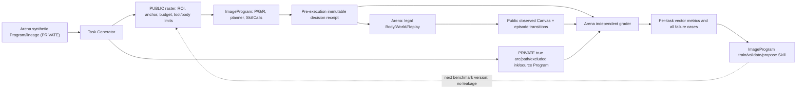
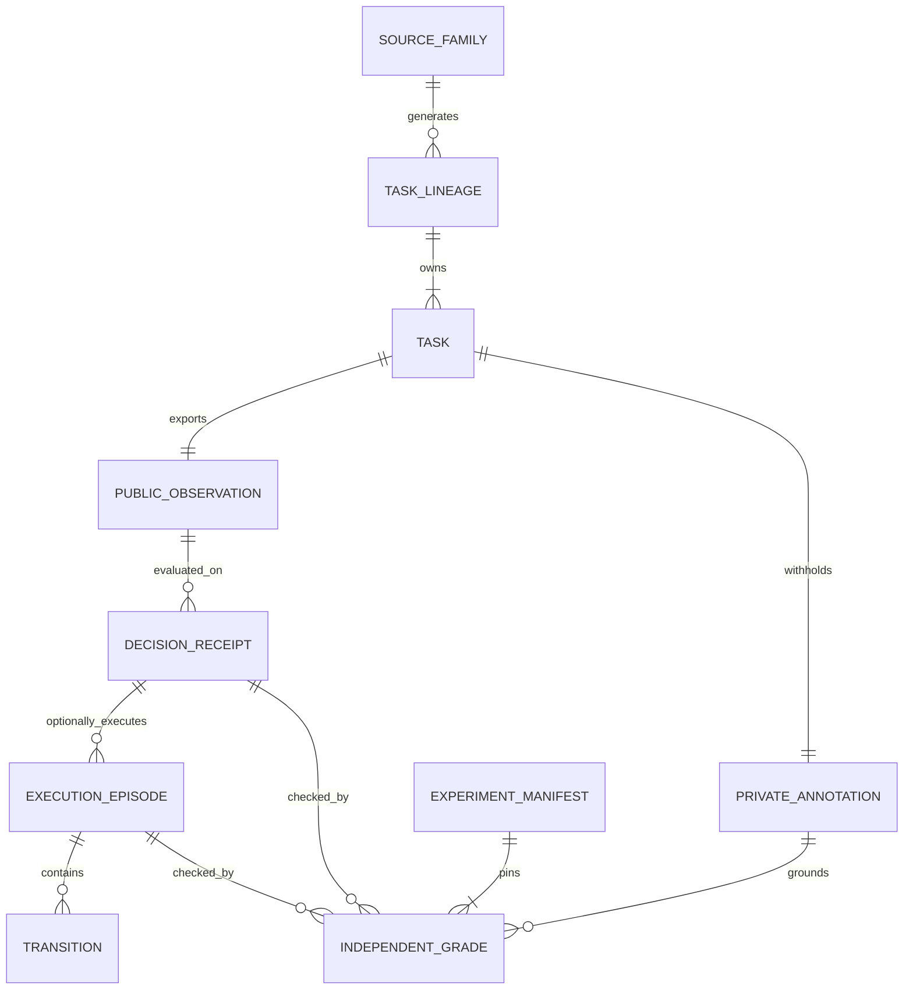

# 自律作画研究のArena教材・独立評価プロトコル（提案）
**Date:** 2026-10-16 JST  
**Status:** DESIGN PROPOSAL / NOT RUN; zero new fixture, annotation or score  
**Role:** ImageProgram-Arena = tasks, execution, private source/oracle, independent grading, episode provenance  
**Model research counterpart:** [ImageProgram roadmap](https://github.com/ryonakayama234/ImageProgram/blob/research/learning-capability-roadmap-20261016/docs/AUTONOMOUS_PAINTER_NEXT_CAPABILITIES_20261016.md)

## 目的と制約
Userの方針: 学習基盤はsynthetic known-program tasksで立ち上げ、Real Art intakeは成熟後にArena側で行う。人間/LLMの生画像参照による教材設計をモデル自身のEye認識の成果に混ぜない。現在の [CC-02-V #99](https://github.com/ryonakayama234/ImageProgram/issues/99), [CC-02-P #100](https://github.com/ryonakayama234/ImageProgram/issues/100), [CC-02-R #101](https://github.com/ryonakayama234/ImageProgram/issues/101) と [Arena CC-02 ADR](https://github.com/ryonakayama234/ImageProgram-Arena/blob/research/contextual-contour-cc02/docs/ADR_CC02_001_PERCEPTION_REASONING.md) は現行の判断正本。本提案でその既存confirmation 6 pairsのseal・各task hash・過去score・privateデータを変更しない。

## System：公開/非公開の境界

モデルへ渡してよいのは、許可済み公開観測/目標/道具/予算および実行後の公開Canvasに限る。PRIVATE annotation、作者の本当のstroke順、非公開完成図、裁定基準はgrading専用。Oracle-P/Rはdevelopment診断のみで一般能力/confirmationに含めない。

## ER：課題→観測→行動→独立評価

**提案レコード（既存 canonical を無断変更しない）**
- TaskLineage: generator version, family, template ancestry, geometric transform ancestry, label-access policy。関連family間は分割を跨がせない。
- PublicObservation: permitted raster/focus/anchor/observation-budget hash と codec/frame/scale。モデルの決定前に公開入力identityを固定。
- PrivateAnnotation: allowed target/excluded arcs, junction ambiguity, source process if genuinely known, rights/source provenance, blind reviewer status; Arena内。
- DecisionReceipt: Model/P/G/R/Skill versions, code/config SHA, candidate graph hash, selected ordered path/STOP/HOLD, effect prediction, timestamp/digest。
- ExecutionEpisode: pinned Body/Renderer/seed, actual World before/after hashes, Transition, motor/compute/time budget, Replay/validity。
- IndependentGrade: support coverage + false positive ownership + false joins + selected-path accuracy + UNKNOWN/HOLD + permitted ink + stroke continuity + costs。task-familyごとに分母を明示。
- ExperimentManifest: code heads, dependency lock, split seal, source lineage hashes, query/compute budget, evaluation implementation hash, paired-arm identity, prediction-before-grade receipt。

## 合成課題の階段（各stageは能力gateで昇格）
| Family | 目的 | 基準/反例 | 状態 |
|---|---|---|---|
| S0 単一開線 | endpoint/tangent/合法strokeの再生 | no-op、旧fixed polyline; endpoint jump | FUTURE |
| S1 曲線と隣接線 | 途中で見失わず一つの線を選択 | crossing, parallel, false joins, STOP/HOLD | 現CC-02研究を再利用・別fixtureの結果は未実施 |
| S2 T/Y/X・弱線 | candidate PとG/Rの因果切り分け | shared junction/target ownership leakage、予算超過 | 現 #100/#101と独立に割当 |
| S3 線をきれいに完成 | fit→合法stroke→reobserve/replay | forbidden ink、端点/接線不連続、汚い重ね描き | CC-03 gate後 |
| S4 短い束/モチーフ | 複数strokeを参数化したSkillへ圧縮 | same example memorization、別曲率/向き/brush OOD | L-01 gate後 |
| S5 短い構図 | 複数モチーフの位置/遮蔽/質量 | 未学習組合せ、構造だけ/見た目だけのshortcut | L-02 gate後 |
| S6 real-art intake | 真の原画の局所観測、再演、転移 | source/permission/annotation audited、未知はUNKNOWN | あとでOwnerがArenaへ投入 |

**分割:** seedはreplication、独立なtask lineage/source familyをtrain/val/testに分ける。transform違いや同一母形状由来の兄弟を跨がせない。既存sealed CC02 confirmationを流用して新学習モデルを選択しない。新しい教材familyなら新しいmanifestとschema_versionを作成。n=6/8のPASSを一般化の統計証明と呼ばない。

## 研究仮説と反証
- H-A P-only: positive candidate coverage改善と同時にexcluded-only contamination/false joinが増えるなら失敗。候補数とCPU/画素/Node上限を報告。
- H-B G/R: frozen Fragment/Relation sets上の独立比較で正経路と真STOP vs 不確実HOLDを区別できるか。二値CONTINUE正答だけで正pathとみなさない。
- H-C Drawing: correct pathを与えても合法性/Replay/質が崩れるなら、失敗はMotor/fit/Bodyの別責務として観測する。発見Skillの学習効果と混ぜない。
- H-D Learned Skill: primitive-only、固定手作りSkill、discovered Skillをpaired task/Body/seedで比較。展開後primitive calls・運動距離・描画品質・探索費用・転移/退行を一緒に測り、「Macro呼出し数減」だけで合格にしない。
- H-E Practice policy: uncertainty-driven task choice と同予算uniform samplingで、新規source family性能の差を検証。異なるBody/brushから来たepisodeは素朴にweight平均せず、provenance付きで学習統合。

## GitHub記録の責任
モデル側PRのSystem/ER/Data/Experiment/Decisionに対して、Arena側PRに **private契約・独立grade・split/manifest・replay・failures・leakage診断** を同じ作業単位で相互リンクして追加。計画と実測の列を分け、FAIL、UNKNOWN、NOT RUN、test skips、有料CI未実行を可視化する。大きな画像/weights/private原画はGitに入れない。Code SHA・config hash・experiment seedと再実行bashを保存する。確認群の結果を見てからgate/閾値を変更しない。

## 今回の実行記録
- 新コード: NOT RUN
- 新合成fixture: NOT RUN
- 新しい実画像・Google Drive sourceをModel/Policyへ渡したか: NO
- Training / Skill promotion / Arena grade: NOT RUN
- Frozen CC02 confirmation: NOT SCORED
- Merge / Paid CI: NOT RUN
**Decision:** 研究順序・境界・評価契約を提案するのみ。現行CC02結果・アート適応・学習済み画力は更新しない。
