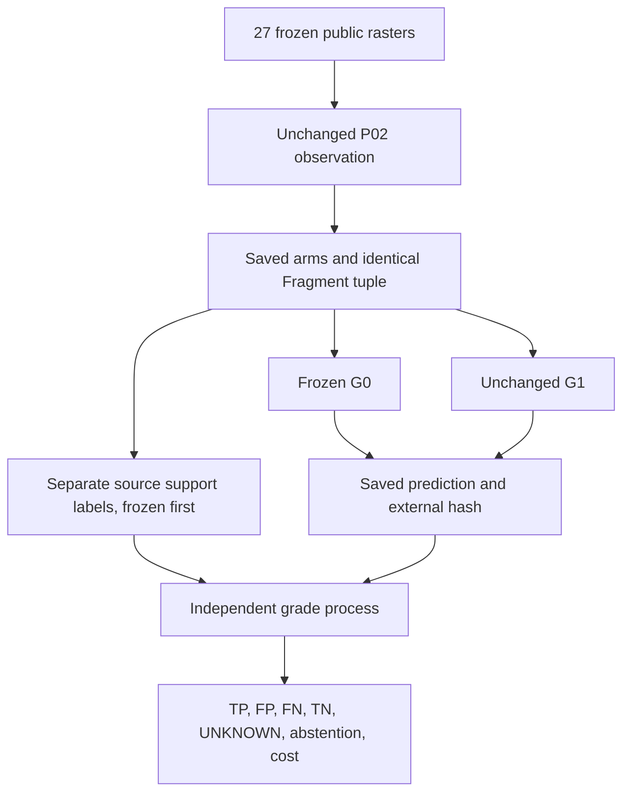
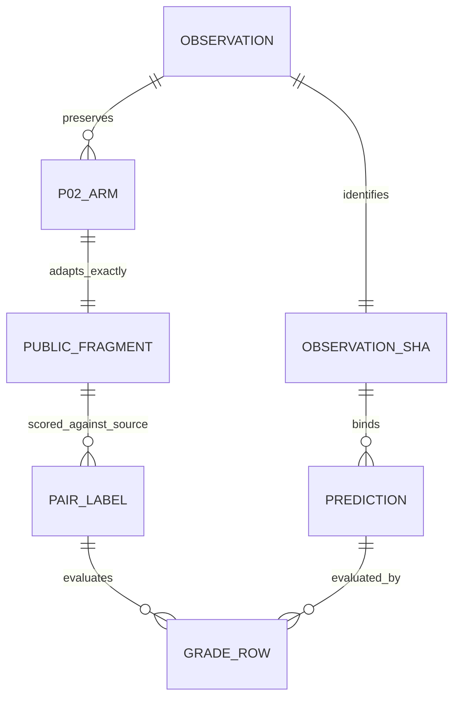

# G1 / actual P02 observation protocol v1

Status: development diagnostic, protocol frozen before formal saved prediction and
grade. Original G1 thresholds and default budgets stay unchanged. Not a new
confirmation set, blind human review, artwork task, selected path or drawing.

Purpose: validate source-exact G1 under locked Python 3.12 and measure both
accessible correct joins and false joins on fragments actually extracted by P02.
The earlier directly constructed Fragment geometry bank remains a separate unit
diagnostic. An exploratory inspection of the 27 public P02 outputs and G0/G1 edge
counts preceded this protocol; no blind/prospective performance claim is made.

## Frozen inputs and single intervention

Use all 27 existing W0 public raster inputs in their original order: 12 development,
3 controls and 12 technical scenes. Never call the original confirmation generator.
P02 thresholds, budgets and strong P0 graph are unchanged. Persist all P02 statuses,
including empty arm banks and budget failures. Do not select only informative scenes.

The primary G-only input is **P02 arm candidates only**. Preserve endpoints,
tangent, mean intensity, region and support count exactly in a one-to-one Fragment
adapter; use neutral node IDs. Save the complete source arms and common Fragment
digest. Do not add P0 nodes, oracle geometry or new support at junctions. P0 is checked
for exact equality and its graph hash retained, but not mixed into the arm bank:
doing so would require a separate duplicate/overlap contract.

Run frozen G0 `_relation` and unchanged G1 `propose_relations` on exactly that tuple.
Keep every candidate edge, absent pair, ambiguous relation and budget abstention.
Fixed G1 defaults: max gap 8px, max pairs 128, max relations 128. All unordered node
pairs enter the label manifest; no G-produced edge list defines the denominator.

## Independent source-based labels

The separate Arena scorer uses the **pre-existing source strokes** of the 12
technical images. It independently rasterizes each source stroke and verifies the
complete image byte digest before using pixel membership. A P02 arm receives a source
stroke ID only when its entire nonempty observed support belongs to exactly one
source stroke. Two uniquely assigned arms of the same stroke are positive; uniquely
assigned arms of different strokes are negative. Mixed/nonunique support is UNKNOWN.
This tests continuity in the known generating program; raster alone cannot establish
an artist's intended ownership or historical motor stroke. In particular, an edge
hypothesis is not a selected or executed false join.

The 15 older DEV/control images expose region/action proxies but no independently
specified complete source-arc identity atlas. All their observed pairs stay UNKNOWN;
do not recycle the old target-region boxes or infer truth from model decisions.
They remain in all scene, extraction, cost and uncertainty accounting.

This is independent **evaluation code and process**, not an independent human
annotator. No blind/adjudicated annotation claim. The source-program rubric does
not replace #99's real-art topology/task audit. Labels are persisted and their hash
externally published **before formal G prediction**, then the prediction hash is
externally published **before separate GRADE**. The grader never calls P02/G0/G1.

## Metrics and denominators

- Positive labels: possible_continuation = TP; adjacent/absent = FN;
  ambiguous or empty budget bank = positive abstention.
- Negative labels: possible_continuation = FP (source-incompatible hypothesis);
  adjacent/absent = TN; ambiguous/budget bank = negative abstention, never TN.
- UNKNOWN: show possible hypotheses and other outcomes separately, no success credit.
- Zero-fragment images yield zero observable pairs, **not** true-negative scene successes.
  Report their number and P02 status separately. This is conditional relation accuracy,
  not full end-to-end task recall or successful observation on all 27 images.
- Report per-image, per-family and micro counts, paired disagreements, node/pair/endpoint
  work and actual wall timings. Shared source scenes and related templates make edges
  dependent; do not run significance tests or claim generalization from edge counts.

Success of execution means clean pinned full-source Python 3.12 validation, unchanged
P0/P02/G0/G1 semantics, hash-bound observed inputs and independent grade. A performance
improvement is a separate question and may be absent. Keep negative evidence; do not
tune G1 on the scored results in this experiment. No merge/promotion is implied.

## System / data

## Reproduce (separate processes)

From a clean pinned Arena and locked Model environment, set `PYTHONPATH` to Arena
and Model/src. Invoke module
`adapters.imageprogram_reference.contour_relation_g1_observed` with:

1. `--phase observe --out observation.json`.
2. `--phase label --observation observation.json --observation-sha256 OBS_SHA --out labels.json`.
3. Externally publish OBS_SHA and LABEL_SHA before prediction.
4. `--phase predict --observation observation.json --observation-sha256 OBS_SHA --out prediction.json`.
5. Externally publish PREDICTION_SHA before grading.
6. `--phase grade --observation observation.json --observation-sha256 OBS_SHA --labels labels.json
   --labels-sha256 LABEL_SHA --receipt prediction.json --expected-sha256 PREDICTION_SHA --out grade.json`.

Each process prints its canonical JSON digest. Exclusive creation rejects overwrites;
use outputs outside source checkouts. Public observe/predict stages reject label and
grade arguments. Save full logs, exact source SHAs, dependency versions, all failures,
per-case rows and anchors with the eventual result report.
