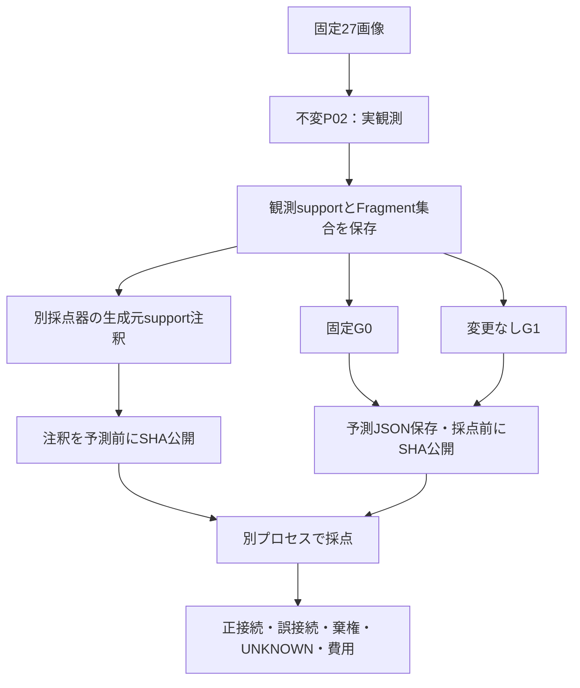
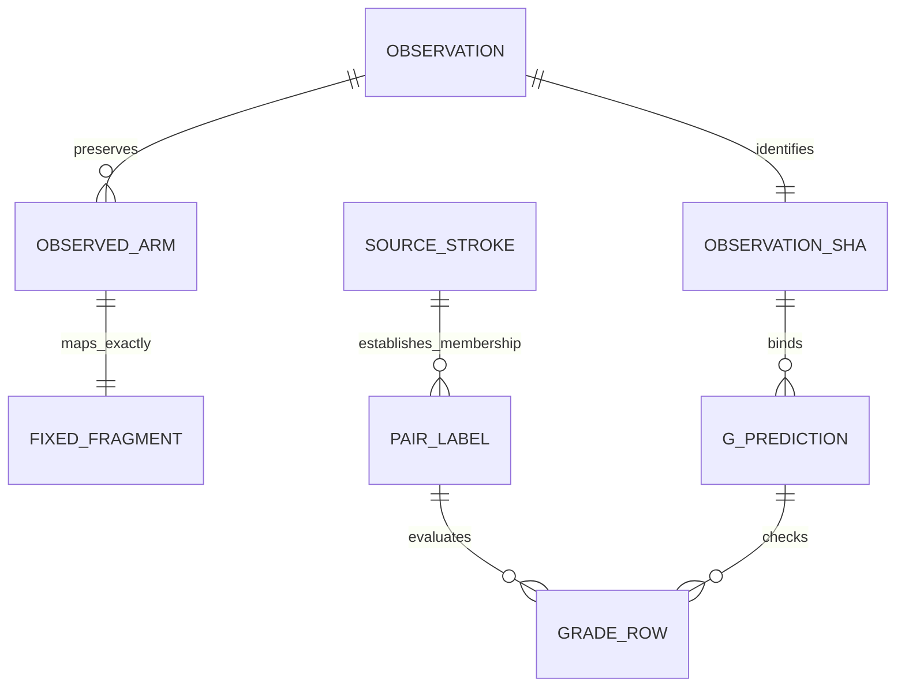

# CC-02-G1：Python 3.12全体検証とP02実観測線分の独立採点

2026-10-16 JST / **検証工程PASS、G1の改善は未確認。Draft維持・未マージ。**

達成したことは、G1を実物の全ソースとlockfileで検証し、直接用意した人工Fragmentではなく、P02が画像から実際に観測した断片集合でG0/G1を比較すること。正しい接続と誤接続はModelを呼ばない別のArena採点工程で評価した。画像自体は既存の**合成DEV/技術課題**であり、実作品の作者意図・筆順・描画能力の評価ではない。

## 1. 結論と検証

| 項目 | 実測 |
|---|---|
| Python / 導入 | 3.12.14、`uv sync --locked --extra render --python python3.12` PASS |
| Model全体 | 301/301 PASS、skip 0。G1既存8テストを含む |
| 元Arena全体 | 168/168 PASS（現行164＋履歴Model指定4）、skip 0 |
| 最終Arena全体 | **176/176 PASS**（現行172＋履歴4）。実観測・改ざん・誤接続/FN・棄権の新8テストを含む |
| 既存W0 runner | 6/6 PASS |
| 両repoの全Ruff / Model doctor | PASS |
| 実観測G0/G1 | 同一32 Fragment、全37対でrelation kindの差 **0** |

NumPy2.5.3、Pillow12.3.0、Pydantic2.13.5、pydantic-core2.46.5、Ruff0.16.7。Modelの全テストは114.763秒（コマンド全体116.523秒）。Modelコードは変更していないため、その後の無関係な全再実行はしていない。Arena追加後は完全matrixを再実行した。

Git cloneは認証経路がなく失敗したため、接続済みGitHubのGit Data APIから元のcommit/tree/blobを取得し、全SHA一致の浅いGit checkoutを復元した。互換stub・手書き代替ソースは使用していない。全履歴cloneの検証とは主張しない。

固定したModelは `531d78d365b4c7882a3898a3e11fda3e809b4857`、最初のArenaは `93332e4a2e63e345da722c7d144fd201cbba3ace`。実験harnessはArena `7a7c26815472ae2bc866415f04c5d9888f0d4021`、最終コード検証はArena `3dfe11a6b7c7e5d351020bae28f252fcda2d37b4`。後者はmatrixパス修正と検出感度テストの追加のみで、観測・予測・採点コードは前者と同一。履歴E1の4テストは元の必須Model `6d8e6399a2b0a44d08054a08b71b4a68d4d9e374` とそのlocked環境で実行し、省略・pin緩和していない。

## 2. 仮説・単一変更・独立性

H-G1は「観測断片を固定して関係推論だけを置換すると、正しい接続が増え、誤接続が増えない」。P02抽出器、P0、G0、G1閾値・予算・R0・Motor・Worldは固定。既存27入力を全件使用し、G1が得意そうな入力の追加や結果を見た閾値調整は行わなかった。

P02のArmHypothesisを一対一でFragmentに適合させ、端点・接線・画素数・濃度・regionを変更せず共通SHAを保持。G1へ渡すのはこのpublic Fragment tupleだけ。P0のgraphも不変を照合したが、重複候補を生むunionは今回行っていない。入力は**P02 armsのみ**であり、一般的なP0＋P02統合graphの性能とは区別する。

採点器は既存12技術画像の生成元strokeを別実装でrasterizeし、元画像SHAを一致確認した。観測support全体が唯一の生成strokeに属する場合だけ線IDを付け、同じstrokeの断片対をpositive、異なるstrokeをnegativeとする。混合・非一意・線同一性の注釈がないものはUNKNOWN。既存DEVのtarget-region/action proxyやModelの選択は正解作成に使わない。

これは**Modelから独立した採点実装・プロセス**であり、独立した人間によるblind注釈ではない。事前の探索的edge数確認とunit testはプロトコルに明記した。source-strokeの連続性という操作的定義に限定し、複数strokeで描かれた一本の輪郭やY分岐でどの方向を選ぶべきかという意味的正解を主張しない。

## 3. システムとデータの流れ

観測・注釈は[予測前anchor](https://github.com/ryonakayama234/ImageProgram/issues/101#issuecomment-6216302521)、予測は[採点前anchor](https://github.com/ryonakayama234/ImageProgram/issues/101#issuecomment-6216309631)に固定。その後の別工程は保存済みJSONと外部SHAを照合して採点し、P02/G0/G1を再実行しない。

| Artifact | canonical JSON SHA256 |
|---|---|
| Observation | `01d4cb52b2cc62f86c06730b9bc00982e03209ad14b2c7b519f0d1d1796b0af0` |
| Labels | `658ae62c8a5d376efe67cc9bd329bde54911893c8a5e318cf726f0039002a0d7` |
| Prediction | `b6977528ba504b3eed2ffdef6dde5bc6a403a6453cae0539d8e9468ea2c64004` |
| Grade | `01c6006e63a1fc292edce78a4cbeb129a105bf4a6cc665558fa0ed8b9d5af99b` |

pretty JSONのファイルbyte SHAとは異なる。全ファイルSHA、全27行の個別評価、版・失敗・費用は同伴のmachine-readable evidenceに保存。

## 4. 結果と失敗を含む全母数

| 指標 | G0 | G1 |
|---|---:|---:|
| 正接続候補 TP / positive全数 | 7/7 | 7/7 |
| 誤接続候補 FP / negative全数 | 0/20 | 0/20 |
| negativeへの正しい非接続 TN | 20 | 20 |
| 見逃し FN | 0 | 0 |
| 既知正解対での曖昧・予算棄権 | 0 | 0 |
| UNKNOWN対（成功数には含めない） | 10 | 10 |
| UNKNOWN対への接続候補（正誤未判定） | 2 | 2 |

27個の既知対は**7技術画像**から得たもので、27独立画像ではない。全37対のedge kindが同じで、改善0・悪化0。人工Fragmentでの従来4/6→6/6は既存全体テストでも再現したが、**実観測された今回の分布へ改善は移らなかった**。

| 全入力の状態 | 件数 |
|---|---:|
| 元画像数（DEV12＋control3＋technical12） | 27 |
| P02が枝断片を返した画像 | 10 |
| 実観測Fragment総数 / 全対数 | 32 / 37 |
| P02が空集合を返した画像 | 17 |
| うち非予算の空集合 | 15 |
| うち予算超過（thick-t / junction-grid） | 2 |

空集合17件は接続accuracyのTNに足していない。P02はjunctionの枝を抽出する追加観測器であり、junctionなし画像の空集合は直ちにP0の知覚失敗を意味しない。一方、**全27画像で目的輪郭を取得・接続できたという意味でもない**。positiveがそもそも生成されなかった事例のend-to-end recallは別課題である。

技術課題別（G0/G1同じ）：

| 画像 | P02断片 | TP | TN | 状態 |
|---|---:|---:|---:|---|
| t-right | 3 | 1 | 2 | ok |
| t-left | 3 | 1 | 2 | ok |
| y-up | 3 | 0 | 3 | ok。作者意図の分岐選択ではない |
| y-down | 3 | 0 | 3 | 同上 |
| x-one | 4 | 2 | 4 | ok |
| x-two | 4 | 2 | 4 | ok |
| parallel | 0 | — | — | ok、非junction |
| near-miss | 0 | — | — | ok、非junction |
| corner | 0 | — | — | ok、非junction |
| thick-t | 0 | — | — | junction-budget-exceeded |
| t-distractor | 3 | 1 | 2 | ok |
| junction-grid | 0 | — | — | arm-budget-exceeded |

## 5. 費用・負の証拠・検証中の修正

P02 pixel-pass-equivalent合計279,936、G pair37、G1 endpoint組合せ148。全27例の一回計測wall時間はP02約36.65ms、G0約1.36ms、G1約1.60ms。microsecond規模の単発計測なので速度優劣の根拠にはしない。API課金・GPU・paid CIは使用していない。

新テストの初回にtupleの要素代入でfixture変更テスト自身が失敗し、tupleを置換するよう修正した。production観測や予測は変更していない。最初の追加後matrixは現行171テストを通した後、workerが相対出力先を別cwdで解決してレポート保存に失敗し、履歴partitionへ到達しなかった。失敗ログを保持し、`args.out.resolve()`でprocess境界前に絶対化した。元の外部cwd・相対`--out`で再実行し最終176/176・全ID一致・skip0を確認した。

改ざん後のSHA拒否、一対一adapter改変、外部nodeへのedge、棄権をTNにしないこと、FPとFNの両方を意図的に注入した採点感度、採点時にP02/G0/G1を呼ばないことを検査。Wolframでも7＋20＝27、UNKNOWN込み37を照合した。参考として独立二項試行なら0/20の両側95%上限は約16.84%だが、実際のedgeは7画像内で依存しうるため、この数を本実験の信頼区間として採用しない。誤接続ゼロを一般的安全性の証明としない。

## 6. 研究判断と次の問い

- **SELECT:** Python3.12 source-exact検証とP02実観測の固定入力比較、独立source-support採点を研究基盤として採用する。
- **REJECT:** G1が実観測でも改善したという主張、0/20を未知画像での誤接続ゼロ保証とすること、空集合・UNKNOWNを成功に数えること。
- **DEFER:** G1の正式昇格・マージ、R1/描画/Motor/Skill、原confirmationの消費。すべてDraftのまま。
- **NEXT 1:** 今回は直線を分岐点で分けた断片が中心だった。P02が実際に抽出した**曲率・短い斜め接続・遮蔽/近接線**の固定観測に対して、source-arcの連続性と競合線を事前注釈し、G1が改善しうる分布を検証する。目的はG1を勝たせる課題作成ではなく、既存成功反例が実観測に現れるかを切り分けること。
- **NEXT 2:** 古いDEVの10対は線同一性が未注釈で、うち2接続候補は正誤不明。#99でL0可視support/L1接続/L2課題意図を区別した注釈を固定する。UNKNOWNを解消できなければHOLDとして扱う。
- **NEXT 3:** P0＋P02全候補を使う段階では、重複・混合support・junction端点の不確実性を保ったadapterを別比較で定義する。その後、同じgraphでRの順序付き経路とSTOP/HOLDを評価する。幾何的に接続可能な仮説を、そのまま描いてよい線へ昇格させない。

現在の最終目的は、単に位置を合わせることではなく、**どの線を続け、どこで止めるかを証拠と不確実性に基づいて選び、ひとまとまりの描画として実行できること**。今回の成果はそのためのG段階の検証と、改善がまだないという反証可能な記録である。

再現コマンドと採点rubricは[Arenaの固定protocol](https://github.com/ryonakayama234/ImageProgram-Arena/blob/7a7c26815472ae2bc866415f04c5d9888f0d4021/docs/CC02_G1_OBSERVED_P02_PROTOCOL.md)。機械記録は [evidence JSON](evidence/cc02-g1-python312-observed-p02-20261016.json)。観測/注釈/予測/採点の全JSON、全検証ログ、実観測比較図は納品evidence packに含む。
