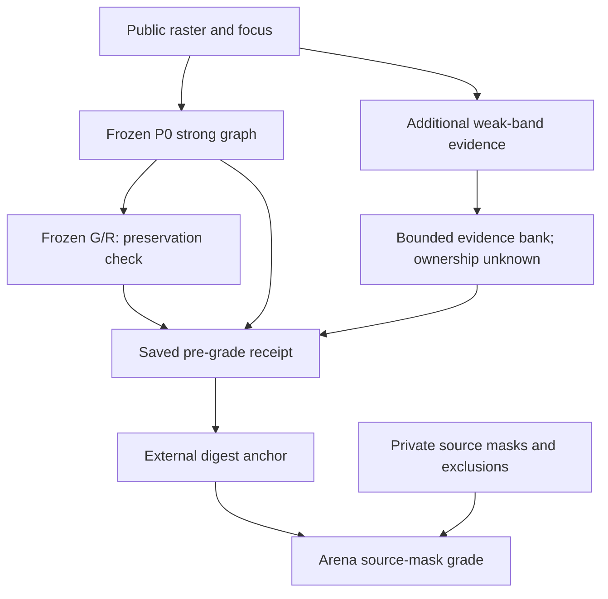
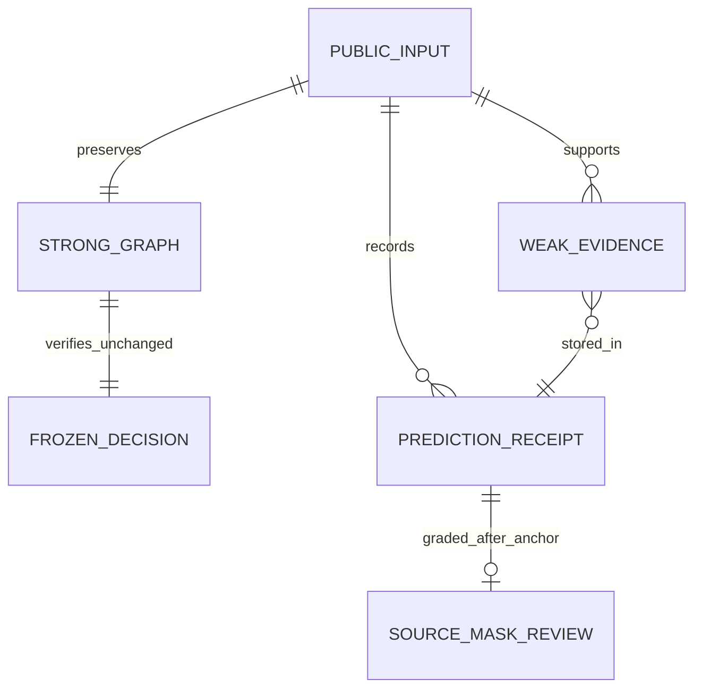
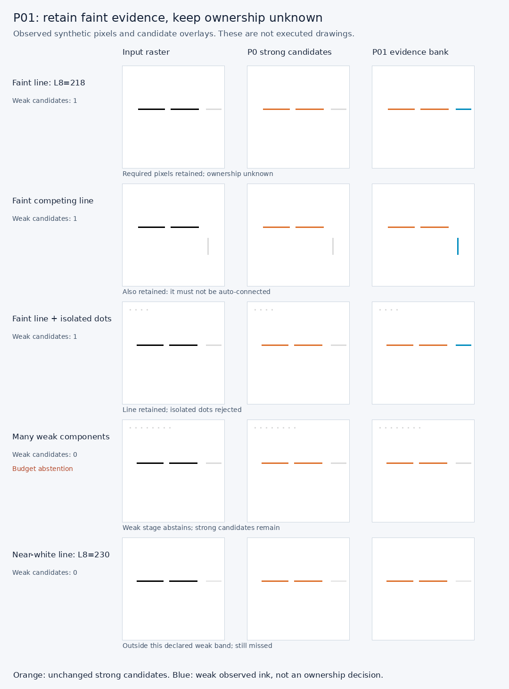

> **Execution update:** technical retention result and all29 cases are below. The prospective protocol is preserved as the original freeze record.

# CC-02-P01 — 薄い線の証拠保持だけを試す
Date: 2026-10-16 JST | Search: CC-02-P01, weak-contour-p01-v1, #100
Status: prospective technical screen; trial prediction/grading NOT_RUN at this commit.

## Purpose / authorization / changed gate scope
Purpose: keep potentially useful faint visible ink available for later relational reasoning without treating it as confirmed target ownership.
The user approved this narrow experiment after the explanation that synthetic pixel retention and semantic ownership/independent art annotation are different questions (2026-10-16 JST).
This is an explicit LIMITED amendment to ADR-CC02-001 / V2's blanket "no P change before independent annotation": synthetic P-only technical retention testing may proceed using source-derived visible masks; #99 independent semantic annotation remains OPEN. This does not authorize claiming correct target grouping, real-art generalization, weak-to-G/R promotion or skill learning.
Old labels, original v2, original confirmation six pairs and results remain unchanged.

## Hypothesis and single intervention
Frozen P0 = CC01/v2 raster threshold200, original connected components, original fragment filter.
P01 = preserve the exact P0 strong graph and additionally inspect only observed pixels in [200,230). Reuse the original minimum5pixel / line-likeness filter. No junction splitting, geometry-filter change, relation change, selector change or learned model.
Weak evidence records observed support, mean L8/contrast, endpoints/region and **ownership=unknown**. Contrast is NOT a calibrated probability. Weak evidence is NOT fed into G/R. Existing G/R is replayed only on the unchanged strong graph as a preservation check.
This is a new research record, not a P1/P2 wire-contract change.

## System

## ER / data

WeakEvidence fields: candidate_id, exact support_xy, endpoints, region, mean_l8, mean_contrast, evidence_kind, ownership=unknown.
WeakObservation contains the original strong graph, weak candidates, weak_status, raw components seen, charged pixel-pass proxy and canonical evidence hash.
Prediction includes source Git SHAs, input digests, original/retained strong graph, frozen R0 decision, three timing repetitions and deterministic candidate hashes.

## Frozen conditions BEFORE trial predictions
- Same 72x72 public input and focus/anchor for P0/P01. Strong threshold200, weak interval [200,230).
- Strong component/raster budgets unchanged; weak raw components at most8, weak accepted candidates at most4.
- Shared work ceiling16384 pixel-pass equivalents. P0 charges5184; P01 charges10368. This is a declared work proxy, not true CPU instructions. Wall time measured separately.
- Weak budget overflow returns an explicit abstention and NO partial weak bank. Keep strong graph and its decision intact. Do not classify overflow as proven target absence.
- Existing DEV12 + controls3 =15; new14 technical cases =7 intensities (199,200,201,218,229,230,245), salt4, blob3x3, parallel line, component flood, candidate flood, blank, short4.
- Each P0/P01 observation repeats3 times. Deterministic content hashes must agree. Runtime median/raw timings retained; no speed significance inferred.
- New masks use direct array slices; grading independently enumerates support coordinates. Existing annotation is source-derived, not blind independent adjudication.
- No prospective confirmation factory or Model inference on original confirmation inputs. No original art, Drive image import or Site editing.

## Measurements / interpretation, no tuning on the original confirmation
1. Exact strong graph and frozen R0 equality on all29 inputs, with unchanged P0 source module.
2. Target arc coverage P0/P01 (1px tolerance), weak candidate/competing-support counts, status and computation costs.
3. Known L8=218 horizontal target should be retained while strong-only R0 remains unchanged. This is a technical development result, not a semantic target-selection score.
4. Isolated points and blob should not create extra weak candidates under the existing filter. A real faint competing line may remain as evidence; count it and preserve ownership=unknown instead of claiming it was recognized as irrelevant.
5. Include near-white >=230 and short4 limitations; retain both overflow failures in the denominator. Report all29 rows, not only the recovered target.
6. Report six old positive candidate-coverage cases separately. Original #100 provisional5/6 gate is NOT waived, and P-only retention does not establish the contextual-contour ability.
7. If P01 only recovers the known faint example but still accepts a faint distractor, decide that ownership/promotion is unresolved. Do not automatically connect weak candidates or start Skill training.

## Experiment at protocol freeze
Implementation boundary unit tests: Model5/5, Arena3/3 PASS. New code lint repaired import layout only. Actual29-input trial, full regression, timing summaries and separate grade NOT_RUN at this commit. No new artistic ability claimed.
Full results and initial failures, if any, will be appended without changing the above declared thresholds/labels.

## Next decision
Use measured candidate coverage/cost/competing evidence to decide whether this narrow evidence bank is useful. Branch parsing and relation reasoning remain separate trials; independent semantic annotation and actual path-quality gates remain prerequisites for artistic target-selection claims.

## Executed result — 2026-10-16 JST
**Narrow technical retention hypothesis supported; contextual-contour/#100 capability gate NOT_MET.**
Code pins: Model `507f6b6cfb875e89dbc1ce0e2b9118a92c1e178f`, Arena `a2f8483c0ac5ad6710f17c396a52a3457234afed`.
[Protocol anchor before trial](https://github.com/ryonakayama234/ImageProgram/issues/100#issuecomment-6204860569).
Prediction29 inputs with3 repetitions each; [external receipt anchor before separate grade](https://github.com/ryonakayama234/ImageProgram/issues/100#issuecomment-6204888059).
Canonical receipt SHA256 `4a0a9eb9ba2f7ea0f9efb2004146bc2c6cda42b63a05f92b4c3f0bc31830c5ba`.

- Original faint DEV target218: visible target arc coverage0% ->100% (11 pixels). Six old positive candidate cases:3/6 ->4/6. T/Y failures remain. Original5/6 gate NOT_MET.
- Strong graph and frozen R0 identical on29/29; original P0/G0/R0 module byte SHA256 `a8f286044f355a16b0ed6875a4812b3e4b66bd843b484fa5dc55cf4a4266a330` unchanged. No downstream target-selection improvement claimed.
- Four isolated weak dots and 3x3 weak blob add no candidates; required weak line retained in both cases.
- Faint unrelated DEV line retained12 pixels; added parallel competing line retained11 pixels. Both remain ownership=unknown. Equal contrast does not reveal ownership.
- Component flood and candidate flood:2 explicit weak-stage abstentions /29 inputs, including missed target coverage. Strong graph preserved; no favorable denominator removal.
- L8>=230 and4-pixel fragments still missed under declared thresholds/filter. This is hand-configured evidence retention, not learned contrast adaptation or universal perception.
- Median across29 case medians: P0=0.299701ms, P01=0.393101ms (~1.312x). Three timing reps, one runtime: descriptive only, not hardware/population performance. Charged pixel-pass proxy5184 ->10368 under shared16384 ceiling.

### Full per-input ledger
Coverage is a source-mask diagnostic at1px tolerance, not semantic ownership accuracy. Competing pixels are actual observed ink outside the requested target; their retention is additional ambiguity, not proof of a false executed join.

| Input | P0 target coverage | P01 target coverage | Weak candidates | Competing weak pixels retained | Weak status |
|---|---:|---:|---:|---:|---|
| dev-00-m0 | 100% | 100% | 0 | 0 | ok |
| dev-00-m1 | - | - | 0 | 0 | ok |
| dev-01-m0 | 0% | 0% | 0 | 0 | ok |
| dev-01-m1 | - | - | 0 | 0 | ok |
| dev-02-m0 | 100% | 100% | 0 | 0 | ok |
| dev-02-m1 | - | - | 0 | 0 | ok |
| dev-03-m0 | 0% | 100% | 1 | 0 | ok |
| dev-03-m1 | - | - | 1 | 12 | ok |
| dev-04-m0 | 100% | 100% | 0 | 0 | ok |
| dev-04-m1 | - | - | 0 | 0 | ok |
| dev-05-m0 | 0% | 0% | 0 | 0 | ok |
| dev-05-m1 | - | - | 0 | 0 | ok |
| control-0 | - | - | 0 | 0 | ok |
| control-1 | - | - | 0 | 0 | ok |
| control-2 | - | - | 0 | 0 | ok |
| screen-l8-199 | 100% | 100% | 0 | 0 | ok |
| screen-l8-200 | 0% | 100% | 1 | 0 | ok |
| screen-l8-201 | 0% | 100% | 1 | 0 | ok |
| screen-l8-218 | 0% | 100% | 1 | 0 | ok |
| screen-l8-229 | 0% | 100% | 1 | 0 | ok |
| screen-l8-230 | 0% | 0% | 0 | 0 | ok |
| screen-l8-245 | 0% | 0% | 0 | 0 | ok |
| screen-salt4 | 0% | 100% | 1 | 0 | ok |
| screen-blob | 0% | 100% | 1 | 0 | ok |
| screen-parallel | 0% | 100% | 2 | 11 | ok |
| screen-component-flood | 0% | 0% | 0 | 0 | weak-component-budget-exceeded |
| screen-candidate-flood | 0% | 0% | 0 | 0 | weak-candidate-budget-exceeded |
| screen-blank | - | - | 0 | 0 | ok |
| screen-short4 | 0% | 0% | 0 | 0 | ok |

### Verification / failures retained
Python3.12.14, locked render dependencies. Full Model292/292 PASS (61.302s); Arena complete matrix161 current +4 historical PR81 =165/165 PASS, no skips/omissions. Model full Ruff PASS; new Arena2-file Ruff PASS (not Arena-wide lint). Existing V2 integration tests also passed. Unit boundaries Model5 and Arena3 passed before protocol freeze; formal trial results are the separately anchored29-input receipt, not those unit tests.
Initial offline wheel cache failure followed by successful normal locked sync. Initial matrix current161 passed then legacy interpreter was missing; rebuilt legacy locked environment and reran full matrix. Initial partial logs retained.

### Decision / remaining question
Keep the weak bank experimental and separate from automatic graph promotion. The narrow intervention recovers one known missing faint arc at bounded extra cost but also keeps genuine faint distractors. Do not solve that ambiguity by silently treating all weak candidates as strong or endlessly raising the threshold.
Next scientific question: what public contextual evidence permits a retained weak fragment to become a connection candidate, and when must it remain unknown? That requires a separately scoped G/R experiment, explicit selected-edge receipts and the independent semantic-annotation conditions; it is NOT implemented here. T/Y candidate splitting remains a separate P experiment.
#99 independent semantic annotation and #100 general candidate gate remain OPEN. No original confirmation scores, real-art transfer, drawing/Motor changes, learning, Site editing, paid CI or merge.

Orange=unchanged strong candidates; blue=weak observed ink with unknown ownership. This overlay is not a generated drawing.

Evidence: `cc02-p01-evidence-20261016.zip`,18 files /44,248 bytes; SHA256 `06dacf101c10d82db98cee3400df67d213dd49e129072729fc7f9ce5ceb3325f`, persisted successfully. Raw29-input receipts, all reviews, matrix IDs/logs, setup failure summary, source/config identity and per-file hashes are included. Repository-backed code and synthetic overlay remain in GitHub.

### Reproduce (paired clean checkouts and locked Model environment)
1. Pin the two code SHAs above and the historical PR81 environment required by `scripts/cc02_test_matrix.py`. Install with `uv sync --locked --extra render`.
2. Model: `uv run python scripts/check.py` and `uv run ruff check .`; Arena: run the complete version-aware matrix and the two new-file Ruff checks.
3. In Arena, using the Model environment and `PYTHONPATH` pointing to Arena, run `python -m adapters.imageprogram_reference.weak_contour_p01_trial --predict --out /new/path/receipts.json`.
4. Externally record the printed digest before a separate `--grade --receipts /new/path/receipts.json --receipt-sha EXACT_DIGEST --out /new/path/grade.json` invocation. Keep source checkouts unchanged. Outputs are create-exclusive.
