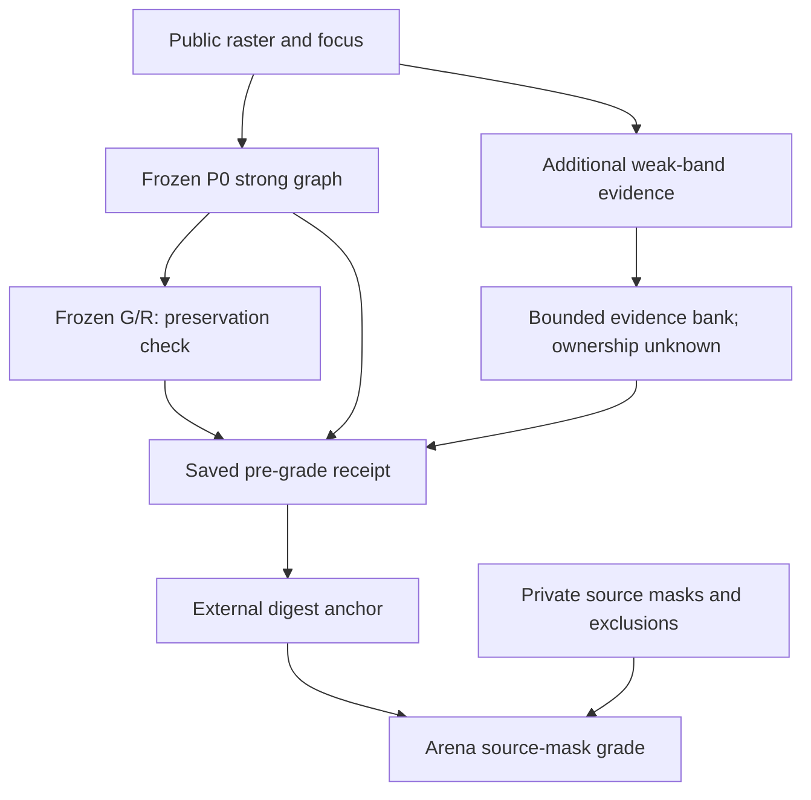
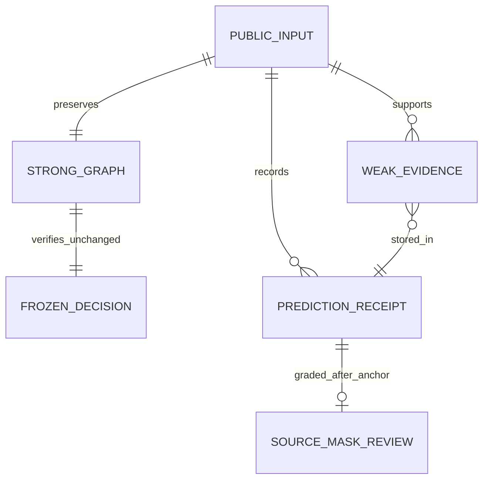

# CC-02-P01 — 薄い線の証拠保持だけを試す
Date: 2026-10-16 JST | Search: CC-02-P01, weak-contour-p01-v1, #100
Status: prospective technical screen; trial prediction/grading NOT_RUN at this commit.

## Purpose / authorization / changed gate scope
Purpose: keep potentially useful faint visible ink available for later relational reasoning without treating it as confirmed target ownership.
The user approved this narrow experiment after the explanation that synthetic pixel retention and semantic ownership/independent art annotation are different questions (2026-10-16 JST).
This is an explicit LIMITED amendment to ADR-CC02-001 / V2's blanket "no P change before independent annotation": synthetic P-only technical retention testing may proceed using source-derived visible masks; #99 independent semantic annotation remains OPEN. This does not authorize claiming correct target grouping, real-art generalization, weak-to-G/R promotion or skill learning.
Old labels, original v2, original confirmation six pairs and results remain unchanged.

## Hypothesis and single intervention
Frozen P0 = CC01/v2 raster threshold200, original connected components, original fragment filter.
P01 = preserve the exact P0 strong graph and additionally inspect only observed pixels in [200,230). Reuse the original minimum5pixel / line-likeness filter. No junction splitting, geometry-filter change, relation change, selector change or learned model.
Weak evidence records observed support, mean L8/contrast, endpoints/region and **ownership=unknown**. Contrast is NOT a calibrated probability. Weak evidence is NOT fed into G/R. Existing G/R is replayed only on the unchanged strong graph as a preservation check.
This is a new research record, not a P1/P2 wire-contract change.

## System

## ER / data

WeakEvidence fields: candidate_id, exact support_xy, endpoints, region, mean_l8, mean_contrast, evidence_kind, ownership=unknown.
WeakObservation contains the original strong graph, weak candidates, weak_status, raw components seen, charged pixel-pass proxy and canonical evidence hash.
Prediction includes source Git SHAs, input digests, original/retained strong graph, frozen R0 decision, three timing repetitions and deterministic candidate hashes.

## Frozen conditions BEFORE trial predictions
- Same 72x72 public input and focus/anchor for P0/P01. Strong threshold200, weak interval [200,230).
- Strong component/raster budgets unchanged; weak raw components at most8, weak accepted candidates at most4.
- Shared work ceiling16384 pixel-pass equivalents. P0 charges5184; P01 charges10368. This is a declared work proxy, not true CPU instructions. Wall time measured separately.
- Weak budget overflow returns an explicit abstention and NO partial weak bank. Keep strong graph and its decision intact. Do not classify overflow as proven target absence.
- Existing DEV12 + controls3 =15; new14 technical cases =7 intensities (199,200,201,218,229,230,245), salt4, blob3x3, parallel line, component flood, candidate flood, blank, short4.
- Each P0/P01 observation repeats3 times. Deterministic content hashes must agree. Runtime median/raw timings retained; no speed significance inferred.
- New masks use direct array slices; grading independently enumerates support coordinates. Existing annotation is source-derived, not blind independent adjudication.
- No prospective confirmation factory or Model inference on original confirmation inputs. No original art, Drive image import or Site editing.

## Measurements / interpretation, no tuning on the original confirmation
1. Exact strong graph and frozen R0 equality on all29 inputs, with unchanged P0 source module.
2. Target arc coverage P0/P01 (1px tolerance), weak candidate/competing-support counts, status and computation costs.
3. Known L8=218 horizontal target should be retained while strong-only R0 remains unchanged. This is a technical development result, not a semantic target-selection score.
4. Isolated points and blob should not create extra weak candidates under the existing filter. A real faint competing line may remain as evidence; count it and preserve ownership=unknown instead of claiming it was recognized as irrelevant.
5. Include near-white >=230 and short4 limitations; retain both overflow failures in the denominator. Report all29 rows, not only the recovered target.
6. Report six old positive candidate-coverage cases separately. Original #100 provisional5/6 gate is NOT waived, and P-only retention does not establish the contextual-contour ability.
7. If P01 only recovers the known faint example but still accepts a faint distractor, decide that ownership/promotion is unresolved. Do not automatically connect weak candidates or start Skill training.

## Experiment at protocol freeze
Implementation boundary unit tests: Model5/5, Arena3/3 PASS. New code lint repaired import layout only. Actual29-input trial, full regression, timing summaries and separate grade NOT_RUN at this commit. No new artistic ability claimed.
Full results and initial failures, if any, will be appended without changing the above declared thresholds/labels.

## Next decision
Use measured candidate coverage/cost/competing evidence to decide whether this narrow evidence bank is useful. Branch parsing and relation reasoning remain separate trials; independent semantic annotation and actual path-quality gates remain prerequisites for artistic target-selection claims.

