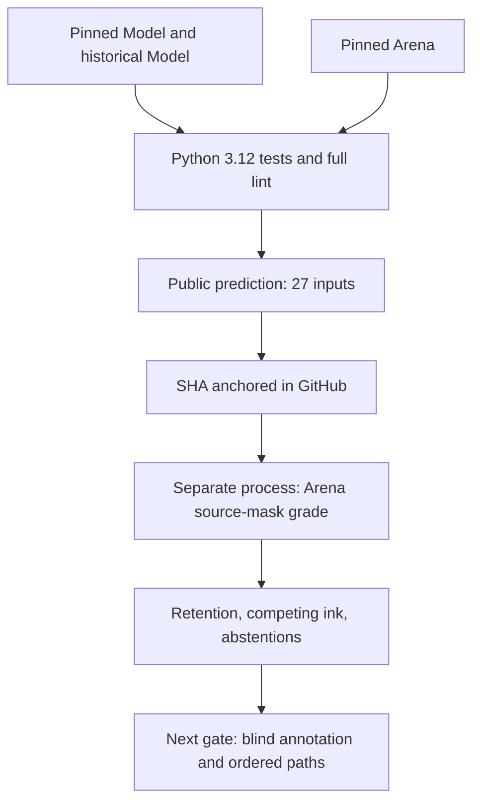
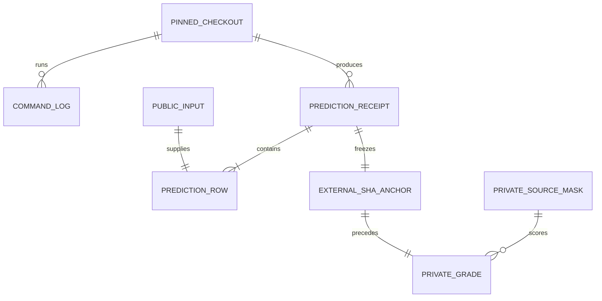

# CC-02-P02 W0 — Python 3.12 full validation and fresh anchored prediction/grade

Date: 2026-10-16 JST. **W0 EXECUTED / PASS after import-only lint repairs.** Research Draft; no merge or promotion. This record supersedes the W0 NOT_RUN statements in earlier implementation records; it does not rewrite earlier receipts or source-derived scores.

## Purpose and fixed sources

Test whether P02 can be executed reproducibly from the complete, authentic paired repositories with locked Python 3.12 dependencies, then save a new prediction before a separate Arena scoring invocation. This run changes no perception algorithm, thresholds, target labels, G/R selection, Motor or World semantics.

| Checkout | Exact executed Git commit |
|---|---|
| ImageProgram W0 | `76164a4ecbfa07b074d105aadae09dd7f567b69a` |
| ImageProgram-Arena W0, final lint repair | `1143a69306c64a5a6f9bbe0d5d7b6e56db1d47fe` |
| Historical ImageProgram PR81 for four Arena tests | `6d8e6399a2b0a44d08054a08b71b4a68d4d9e374` |

Direct git transport required unavailable credentials. Authorized GitHub Git Data API supplied the complete non-truncated trees; cached bytes were reused only when their blob hashes matched. Every source blob, reconstructed full tree, and exact original commit object matched GitHub. These are full shallow source checkouts, **not a network git clone**, partial-module reconstruction, or shim. Separate clean roots and editable installations were used. Subsequent documentation-only commits are not the executed code SHAs.

Environment: Linux x86_64, Python **3.12.14**, uv 0.12.23, locked NumPy 2.5.3, Pillow 12.3.0, Pydantic 2.13.5, pydantic-core 2.46.5, Ruff 0.16.7. `uv sync --locked --extra render --python 3.12.14` succeeded in both Model roots. Initial offline cache misses were resolved through normal locked package installation; no lock change or paid CI.

## System

## Data / ER

`checkout_identity.json` binds the three code SHAs, lock hashes and Model/Arena source digests. Immutable phase directories hold command exit codes and log hashes, PREDICT JSON, separate GRADE JSON and summary. The grade uses source-derived masks; these are not blinded semantic annotations. Data is passed to Model through public raster/focus/budget arguments; this API/process separation is not a security sandbox.

## Full validation, including failures

| Final check | Result |
|---|---|
| Model `scripts/check.py` | **293/293 PASS**, 97.586 s |
| Arena version-aware exact test-ID matrix | **165/165 PASS**: current 161 + historical 4; no skips, failures, errors or dropped IDs |
| W0 runner contract tests | **6/6 PASS** |
| Model full Ruff | **PASS** |
| Arena P02/W0 scoped Ruff | **PASS** |
| Arena full Ruff, run from Arena root with Model pyproject config | **PASS** |

Original Arena `f78a5a74177e132263aae69efcda82399b9af4c2` passed all tests but failed scoped Ruff (one I001) and repository-root full Ruff (ten diagnostics: nine I001 and one unused `math`). The first workspace-root lint attempt classified imports differently (18 diagnostics); its intermediate cleanup still failed repository-root lint (11). That intermediate commit was not used for the reported predictions. The final repair changes ten files, only import order/spacing and deletion of unused `math`. Non-import AST equality was checked for all ten files, followed by the complete final W0 matrix. All failed/intermediate logs remain in the evidence bundle; no failures were silently converted into passes.

## Fresh PREDICT, external anchor, then separate GRADE

1. Full final VALIDATE passed before PREDICT.
2. Executed 27 existing public inputs: six development pairs (12), three controls, and 12 technical fixtures. **Fresh execution does not mean fresh held-out samples**; these are the previously specified cases.
3. Saved the new canonical receipt SHA in [Issue #100 before GRADE](https://github.com/ryonakayama234/ImageProgram/issues/100#issuecomment-6215611767); GitHub created the anchor at 2026-10-16T12:34:49Z. Only after that call succeeded was GRADE invoked.
4. A new Python process loaded the saved receipt and required the anchored SHA. All 27 rows were graded, including both budget abstentions. Confirmation remains `NOT_RUN`.

| Artifact | SHA-256 |
|---|---|
| Canonical prediction JSON used by GRADE | `db60f5475d4a62f79826a5cde14e264cf5829430461964d3c811502e719e6031` |
| Pretty-printed prediction file bytes | `88e12e868a4118b628c88083315d559103ea7aa9cdbba0eaf1245263034b9ce8` |
| Grade file bytes | `4bc737c4248eb3e022bd5612497b7c40ef12ba9af7c4eb215ec2b292fbf68410` |

Canonical and file-byte hashes intentionally differ. Import formatting changed the recorded Arena source hash, so this is a new receipt rather than a reuse of the earlier module-only run.

## Results and limits

| Group | Inputs | P02 execution status | Excluded-only pixels retained in arm cores |
|---|---:|---|---:|
| DEV six pairs | 12 | 12 ok | 14 |
| Controls | 3 | 3 ok | 0 |
| Technical fixtures | 12 | 10 ok, 2 budget abstentions | 115 |
| Total | 27 | 25 ok, 2 abstentions | 129 |

`ok` means the observation bank completed within its budget; it is **not correctness of target ownership or a selected path**. The six development pairs are six related synthetic conditions, not 12 independent artworks.

- Positive DEV T: three arms jointly cover **20/21 target pixels (95.24%)**; best individual arm covers only 10/21. Positive DEV Y: four arms jointly cover **16/17 (94.12%)**; best individual arm covers only 6/17. Preserved fragments do not yet form one chosen, ordered contour.
- Negative DEV Y retains two uncertain arms with **14 excluded core pixels**. Across technical T/Y/X fixtures, **115 excluded-only pixels** remain in the bank. These are competing observed physical ink, not executed false joins. Retention does not resolve ownership.
- `thick-t`: `junction-budget-exceeded`; `junction-grid`: `arm-budget-exceeded`. Both empty P02 banks remain in the full denominator, with P0 preserved. No thresholds were tuned after seeing grades.
- P02 preserved the exact frozen P0 graph and passed the existing R0 candidate-hash checks on **27/27**. It remains disconnected from G/R selection and Motor; no selected-path improvement is claimed.
- P02-only empty banks for simple non-junction lines are intentional; P0 handles those. The combined P0+P02 5/6 candidate-presence proxy is an earlier result, **not newly scored by this GRADE**.

Work accounting: 10,368 pixel-pass equivalents per input, 279,936 across 27, against a declared per-input ceiling of 16,384. This is a proxy, not an instruction count. Single-run wall timings including W0 preflight/process launch were PREDICT 0.292 s and GRADE 0.279 s; peak child RSS about 31.5/28.0 MiB. These are descriptive one-run costs, not performance guarantees. Wolfram independently checked the exact ratios 20/21, 16/17 and 10,368/16,384 (63.28125%); it did not perform repository execution or semantic judging.

## Decision and next research questions

**W0 reproducibility gate is complete.** Keep Model #107 and Arena #43 Draft and unmerged: full source regression is now established, while safe contour ownership/path choice and drawing ability remain unverified.

1. **#99 independent annotation:** Can reviewers blinded to model output identify target/excluded visible arcs, uncertain junctions and legitimate STOP/HOLD cases? Procedural source masks alone cannot answer this; record uncertainty and inter-reviewer disagreement rather than forcing a label.
2. **#101 ordered path:** On frozen P0/P02 fragments, can G/R choose one connected, ordered target path while rejecting competing arms? Score selected edges, excluded-arc contamination and stop/hold correctness separately. A high union recall must not reward a patchwork of unrelated fragments.
3. **Budget robustness:** Can thick strokes and dense junctions preserve useful uncertainty under fixed compute/candidate limits? Treat this as a separate intervention, retaining overflow failures and source-family splits.

P01 combination, original sealed confirmation scoring, real artwork, Motor/Canvas line quality, learned skills, merge and paid CI remain **NOT RUN** in this work. No new generalization or autonomous drawing claim is made.

## Reproduction

Check out the exact three SHAs above into distinct roots, run locked installation in both Model roots, and use Arena `scripts/cc02_p02_w0_runner.py` phases `validate`, `predict`, `grade` with full `--expected-model-head` and `--expected-arena-head`. Save all outputs outside repositories. Run additional full Arena lint from its own root: `MODEL/.venv/bin/ruff check --config MODEL/pyproject.toml .` (replace MODEL with an absolute path). Publish the printed canonical SHA externally before a separate grade invocation. The earlier W0 runbook contains the complete argument structure. Never overwrite phase directories or score the original confirmation during this reproduction.
