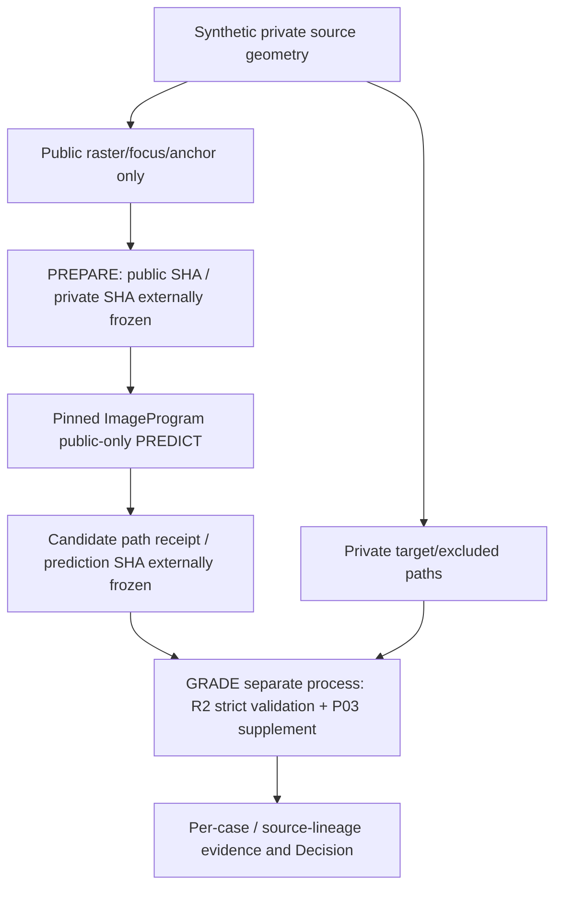
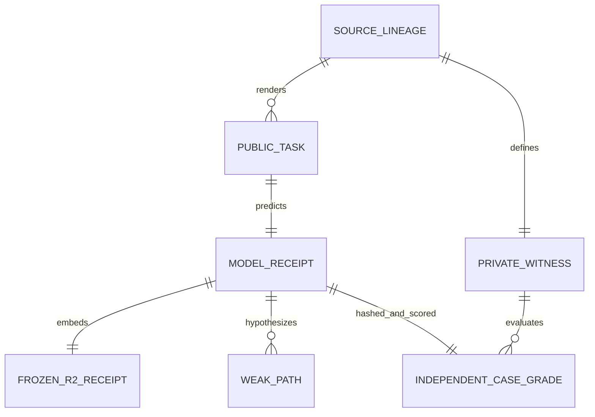

# CC-02-P03 Arena — 独立候補評価と合成実験（Draft）
Date: 2026-10-17 JST | [Arena #48](https://github.com/ryonakayama234/ImageProgram-Arena/issues/48) | [Model #112](https://github.com/ryonakayama234/ImageProgram/issues/112)  
**Status: IMPLEMENTATION WRITTEN / SOURCE-EXACT RUNTIME VALIDATION NOT RUN / NO IMPROVEMENT CLAIM**

This branch stacks on Arena [R2 #47](https://github.com/ryonakayama234/ImageProgram-Arena/pull/47) and consumes Model [R2 #111](https://github.com/ryonakayama234/ImageProgram/pull/111) plus Model P03. No model perception, ranker, skill or motor code is owned here. The original 9-case result remains immutable.

## System

## ER / Data contract

- `cc02_p03_pilot.py`: synthetic task generator and `prepare/predict` phases; never imports Model or reads private target in PREDICT phase. Legacy R2 DEV fixtures rerun for nonregression, not counted as new independent samples.
- `cc02_p03_review.py`: strict saved-receipt SHA, public/private case-universe, full-path, ID, status, source provenance and budget validations. Reuses frozen R2 scorer via an **explicit in-memory version/split adapter** for the nested unchanged baseline, and scores P03 supplementary full paths separately. No model invocation or hidden source import.
- Private `accepted_paths_xy` / `excluded_paths_xy` are only used after prediction SHA is pinned. `family_id` exists only in private manifest. Public Model input is the per-case `pixels_l8, raster_sha256, focus_box, anchor_px, threshold, dominance_ratio, max_candidates`; no family ID.
- `weak_paths` contain ordered points, geometry-stable ID/hash, unknown ownership, and no weak selection; “candidate available” is not the same as “correct target chosen”.
- `private`, raw source images or rights-cleared artwork are NOT committed. These experiments use generated synthetic shapes.

## Experiment and controls

DEV dataset planned by code: 8 R2 legacy synthetic re-renders + 16 positives from four geometry templates crossed with L8 140/160/180/195 + five controls (blank, isolated noise points, near-white line, weak distractor-only and over-budget candidate flood) = **29 cases**. Dataset counts must still be verified in a source-exact run. Source-lineage grouping and counts must use actual generated `public.json`. One source geometry rendered at four contrast levels is paired/correlated, not four independent samples.

Confirmation planned: twelve deterministic seeded draws from a **separate step-slope grammar** (never scored, never tuned) after DEV freeze plus five controls (17 cases). These twelve lineages are distinct draws but not twelve unrelated artwork domains. A discarded earlier parameter-variant confirmation design was previewed in an unverified local algorithm proxy; its observations are NOT confirmation evidence and it has been replaced before any source-exact test.

Evaluation:
- baseline R2 candidate_available; P03 full-bank available; *paired* newly_recovered; conditioned count by geometry and brightness
- exact bidirectional 0.76px target path coverage and endpoints; prefix and decoy fail; weak candidate count, excluded-path exact matches, controls, pixel/vertex and wall-time budgets
- malformed/hash-changed/duplicate case or forged path / private ownership / false completion / claimed selected weak path rejected; no Model import to grade
- failures, controls, abstentions, invalid cases and costs in the denominator / review table; no silently dropping samples

Provisional engineering gate from [Model #112](https://github.com/ryonakayama234/ImageProgram/issues/112): >=10 of 12 previously unused parameterizations have at least one complete candidate, >=3 paired new recoveries, zero strong receipt regression; all privacy/false-completion/budget checks pass. This is not a statistical claim.

## Exact orchestration & current verification

Use Model [documented P03 runbook](https://github.com/ryonakayama234/ImageProgram/blob/research/cc02-p03-faint-path-bank-v0/docs/CC02_P03_FAINT_FULL_PATH_20261017.md). In particular PREPARE, externally append-only public/private SHA anchor, PREDICT with pinned clean Model checkout, externally append-only prediction SHA, **then separate-process GRADE**, with no access to evaluator-private geometry in Model subprocess.

## First user-run WSL2 test evidence — 2026-10-17

Local evidence reported by user from `/home/zhong/imageprogram-p03-idZMcH/validation.log`, before Arena test fix:
- Model commit `07e1975741976cc39a10bb2f16edeb2520499efd`: **295 / 295 Python tests PASS** (`73.756s`), including all ten new P03 tests; **full Model Ruff PASS**.
- Arena commit `ed578bd23662c70e671ae5c127b144495583b09d`: **9 / 10 P03 tests PASS, 1 FAIL** (`0.098s`). Failure: `test_dev_and_confirmation_generators_are_disjoint` incorrectly treated the five intentionally shared immutable controls as forbidden overlapping source IDs. The positive-case IDs *were* disjoint. This was a test-assertion defect, not an OOM or an observed candidate-recall failure.
- Free available memory ~6.8 GiB, no matching kernel OOM trace in the supplied diagnostic; interactive shell had `set -euo pipefail` and exited on the failed test.
- `PREPARE` as a named execution phase, public/private externally pinned SHAs, `PREDICT`, `GRADE`, Arena whole suite, changed-file Ruff: **NOT RUN** (shell exited before those steps). Temporary manifests emitted *within the unittest* must not be confused with the externally pinned DEV/confirmation experiment.
- Follow-up commit [test correction](https://github.com/ryonakayama234/ImageProgram-Arena/commit/e0136d5a80708d0d84add4c06d56da4be5cbda1e): assert distinct **positive** IDs (24 DEV, 12 confirmation) and exact re-use/hash identity of five **negative controls** across splits. This code was committed to the Draft branch, but its corrected result still requires rerun under WSL2.

All numerical measurements above refer to the **previous commit**. Do not re-label them as verification of the new corrected commit. The confirmation test generated manifests but neither model predictions nor private scoring; real held-out confirmation must remain unused pending DEV freeze.

A new source-exact Python3.12 run and full locked tests have **NOT RUN** in this connector-only session. No claimed dev/confirmation success, no 10/12 PASS, and no final performance adoption. Existing R2 historical development observations (6/8, conditional 2/6) are **context only**. Source-exact run requires WSL2 checkouts with the full codebase and matching uv.lock; a GitHub file write is not execution. No paid CI invoked.

## Decision

**SELECT:** Model owns faint observation; Arena independently grades saved paths and preserves private source.  
**DEFER:** all claims of candidate recall gain, predictor→selector promotion, Motor, Skill, user artwork, real-image adaptation and merge.  
**REJECT:** retrospective labeling as prospective evaluation; mixing confirmation with DEV; treating all weak pixels as target; calling a path candidate complete artwork; changing old R2 receipts.
