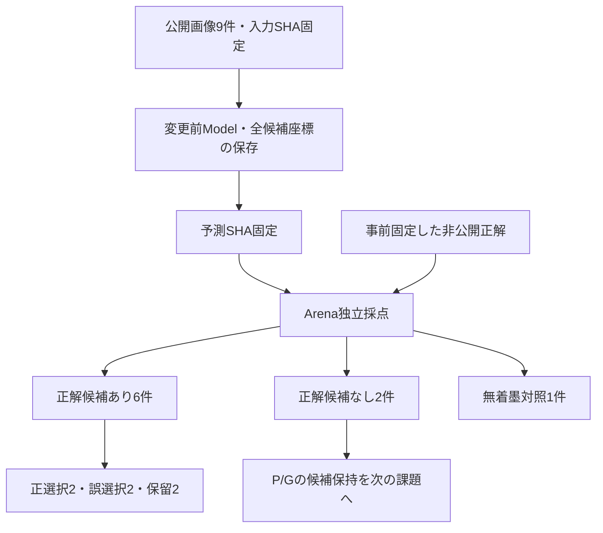
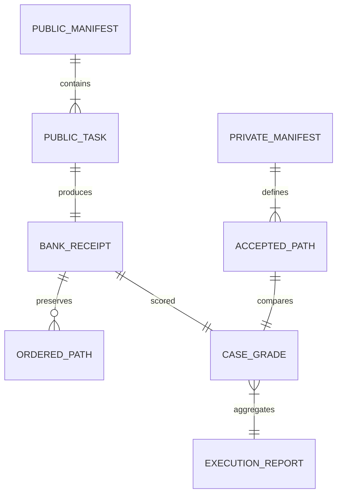

# CC-02-R2：9課題の実行・候補欠落と選択誤りの分離

2026-10-17 JST。ImageProgram #110、Model Draft #111 / Arena Draft #47。
**Stage Aの測定を完了。Candidate recallは6/8（75%）。R1実装・採用・マージは保留。**

## 問いと観測結果

正しい輪郭が候補集合に存在するかを、Modelの選択結果とは独立に確認した。
Modelの候補抽出・閾値・既存選択器は変更していない。

| 開発条件 | 件数 | 正解候補あり | 旧選択器の結果 | 診断 |
|---|---:|---:|---|---|
| 単独線・転置 | 2 | 2 | 正選択2 | 基本動作 |
| 長い隣接線・転置 | 2 | 2 | 誤選択2 | R：存在する対象より長い別線を選ぶ |
| 同程度の隣接線・転置 | 2 | 2 | 保留2 | R：候補はあるが選択を確定できない |
| 薄い対象線・転置 | 2 | 0 | 別線の選択2 | P/G：対象候補が欠落。R単独では回復不能 |
| 無着墨対照 | 1 | 対象外 | unsupported / no-high-contrast-ink、候補0 | 完成を主張せず |

- 陽性8件の候補再現率：6/8 = 0.75。
- 正解候補が存在する6件に限る旧選択精度：2/6 = 1/3。
- 陽性全体の正選択：2/8。誤選択4件のうち2件は候補欠落を伴い、Rだけの誤りに数えない。
- 陽性の完全な分割：候補あり正選択2 + 候補あり誤選択2 + 候補あり保留2 + 候補なし2 = 8。
- 高コントラストの3条件群では候補6/6。薄線2件も全体母数から除外しない。
- 全9件で goal_status=unknown、endpoint_verified=false。終端完成の判定はNOT_EVALUABLE。

## システムとデータ

## 実行の固定と独立性

| 項目 | 固定値 |
|---|---|
| Modelコードcommit | `5725a5b568f99f23d0ceb168c31ccb62233e54da` |
| Model root tree | `2a92a5369e44e4fc831dcde26aad8f488514a2bd` |
| Arenaコードcommit | `a0f88e11d56fb055244494584bacf7ab66202f97` |
| Arena root tree | `e9c5cde637802be313b55ccfe6ab10f5f186de33` |
| 公開manifest canonical SHA-256 | `b91622721c91960652d828ade98e7f31056dd615d6f48c3741b3167aa754cf96` |
| 非公開manifest canonical SHA-256 | `e6e60bca16d399d0720661737c7d8f74cdf937419385c662bd8158b091b4359c` |
| 予測canonical SHA-256 | `47243294a1c2526fce6a9b819a42bca5df7fd59648acf553064df0bf03507523` |

通常のprivate Git cloneは認証不可だった。GitHub接続から取得し、全追跡ファイル（Model210 / Arena41）のblob SHA、root tree、元commit objectを照合したshallow checkoutを利用。履歴全体のcloneではない。予測時の両checkoutはclean。Modelはuv.lockに従って導入したsrc packageを使用した。

公開・非公開入力のハッシュを[予測前に外部固定](https://github.com/ryonakayama234/ImageProgram/issues/110#issuecomment-6232148928)し、予測ハッシュも[採点前に外部固定](https://github.com/ryonakayama234/ImageProgram/issues/110#issuecomment-6232152943)した。採点は別processで保存JSONだけを読み、Modelを再呼出ししない。これは責務・process・入力契約による分離であり、OSの強制アクセス隔離ではない。

## Python 3.12検証

Python3.12.14、NumPy2.5.3、Pillow12.3.0、Pydantic2.13.5、pydantic-core2.46.5、Ruff0.16.7。
`uv sync --locked --extra render`完了。offline導入はcache不足で失敗したが、通常のlocked導入は成功。

| 検証 | 結果 |
|---|---|
| Model `python scripts/check.py` | 285/285 PASS（新規R2 8件を含む） |
| Model `ruff check .` | PASS（repo設定） |
| Arena `python -m unittest discover -s tests -v` | 121/121 PASS（新規R2 17件を含む） |
| Arena R2変更4ファイルのRuff | PASS（isolated、Python3.12、E4/E7/E9/F/I） |
| Arena全体の同Ruff | FAIL：既存ファイルのI001 4件。今回のR2ファイルにはなし |

ArenaはrepoのRuff設定を持たないため明示的なisolated設定で再確認。環境のユーザー設定を継承した最初のRuffは38件を報告し、そのログも保存。既存4件はh5_pilot_bundle.pyのimport順、test_drawing_review.pyの長いimport2箇所、test_h3c_artifact_consumer.pyのimportブロック空行。無関係なスタイル修正は行わず、全体lint PASSとは記載しない。

独立採点の全行は[evidence/cc02-r2-dev9-grade-20261017.json](evidence/cc02-r2-dev9-grade-20261017.json)。全入力、全予測座標、9件のbank receipt、実行環境、検証ログは別途保存する証拠ZIPに含む。

## 推論上の限界と次の判断

family_idの4は**4つの条件群**を意味する。いずれも同じ直線の配置・コントラスト・隣接線を変更したものであり、独立した4形状や実作品4標本ではない。転置8件を独立8標本とも扱わない。Wolframで6/8=3/4、2/6=1/3と8件の分割を再確認。独立4群を仮定したゼロ失敗上限52.71%は説明用の計算にすぎず、本実験の信頼区間には適用しない。

**SELECT**：Stage Aの候補可用性測定は完了。候補欠落と選択失敗を分けて観測できた。

**HOLD**：R1実装・閾値変更・学習・実作品への一般化・正式採用・merge。新たな性能改善はまだ行っていない。

**次の一能力**：薄い対象線を、開始点と公開観測の証拠を使って候補集合に残せるか。現状は対象L8=180が閾値145を超え、対象経路が抽出されず濃い隣接線だけ残る。単なる全体閾値の緩和を今回の実測に混ぜない。別版のP/G候補保持実験として、コントラストを変えた開発入力・無着墨/ノイズ/隣接線対照と成功条件を先に固定し、候補recall・余分な候補・予算・対照での誤選択を評価する。候補なしを完成にしない。

候補保持後に、同じ固定bankを使った開始点条件付きR1と旧選択器を比較する。高コントラスト6件はR単独実験の基準として保存するが、全体達成へ昇格させない。将来の評価では異なる曲率・長さ・位置・分岐・実作品を独立に追加する必要がある。

旧17課題の証拠を変更せず、新しい成績として流用しない。Motor描画・Skill獲得・実作品認識・完成判定は本測定の対象外。
