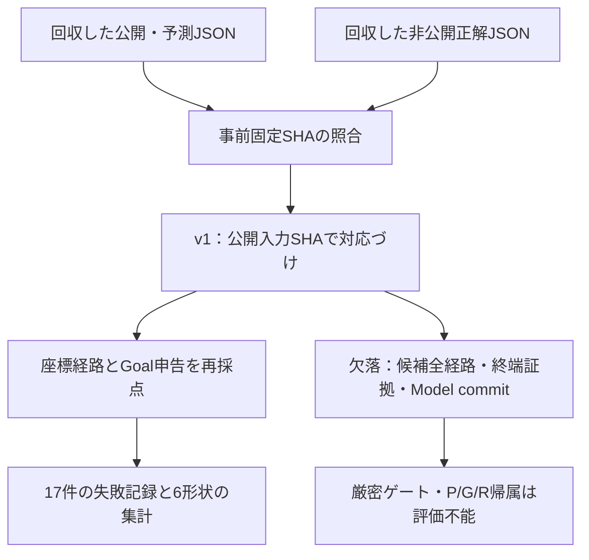
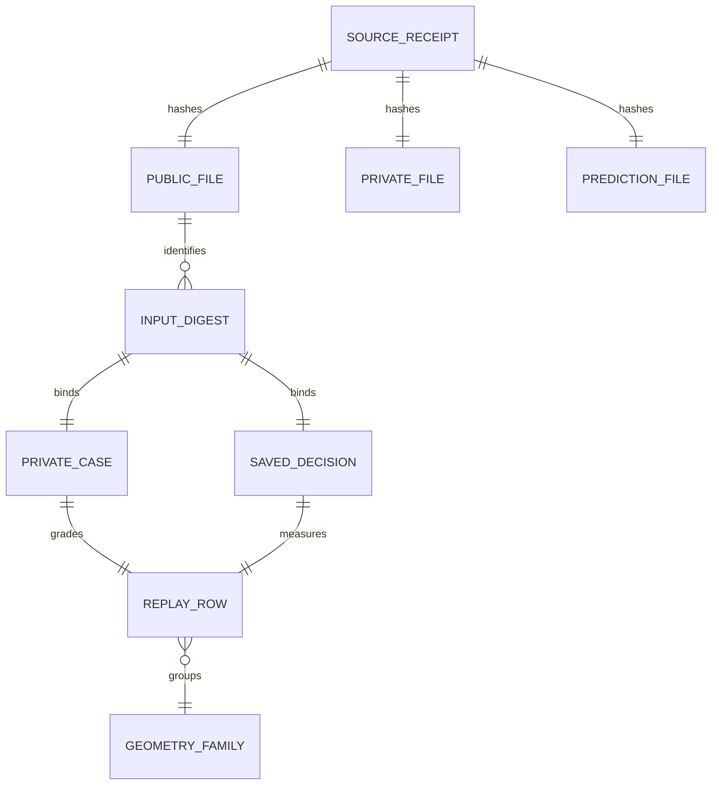

# CC-02-R：旧17課題の回収と独立再採点

2026-10-17 JST。Arena #46 の追加検証。**元JSON回収・登録ハッシュ照合・保存予測の独立再採点は完了。厳密な経路／完成ゲートは評価不能。Draft・未統合を維持する。**

## 目的と結果

旧17件の公開課題・非公開正解・保存済み予測を、以前の作業ディレクトリの `evidence/path-dev` から回収した。再生成や推論は行わず、別ディレクトリにコピーした現物を使用した。Google Drive の `cc02` / `ImageProgram` 検索では候補なし。ハッシュからデータを再構成したものではない。

3ファイルすべての canonical SHA-256 が [事前固定コメント](https://github.com/ryonakayama234/ImageProgram/issues/101#issuecomment-6227167106) と一致した。canonical とファイルのバイトハッシュは別物であり、両方を機械証拠に残した。

| 評価項目 | 実測 | 解釈 |
|---|---:|---|
| 一意課題の経路一致 | 8/12 | 薄い単色線の既定幾何条件による |
| 一意課題の別線選択 | 2/12 | longer_neighbor の転置対。描画や途中の誤接続を実行したという意味ではない |
| 一意課題で経路を選ばず保留 | 2/12 | equal_neighbor の転置対 |
| 終了対照で期待Goalと一致 | 4/5 | 終了理由の正しさまで承認した数ではない |
| 誤った完成申告 | 1/5 対照 | faint_extension。全17件でも1件 |
| 観測証拠を伴う厳密な完成成功 | 評価不能 | 旧記録に必要な証拠がない |
| 正解経路が候補集合に存在した割合 | 評価不能 | 候補の端点・長さのみで全座標がない |
| P/G/R の因果的な失敗帰属 | 特定不能 | 固定された全候補経路と選択経路のGraph対応がない |

8件は旧adapterが `endpoint_only_claim` と申告した経路の幾何的一致である。完成証拠の検証成功ではない。対照では経路が出ていてもGoalをunknownにできるため、v0の「対照ではselected_pathなし」と同じ成功規約には変換しない。全保留方式は一意課題に合格しない。

独立したスカラー計算を実装し、後から既存の保存済み `grade.json` の全17行と比較した。coverage、precision、path_correct、別線選択、誤完成の値はすべて一致。旧採点器コードのimport・呼出しはしない。これは同じ記録の再監査であり、新しい能力試験の追加17標本ではない。

## データ契約と処理の境界

旧形式は公開ラスターの配列、privateの座標列、予測の `ordered_path` を持つ。v0は公開の辺ID Graphと全候補経路、選択経路、観測に結び付いた終端証拠を要求する。データ契約が異なり、情報を保存したままの全変換はできない。

`legacy17_replay_audit_v1.py` を独立した版として追加した。v0を変更・緩和せず、欠けている情報は `null` または `NOT_EVALUABLE` とする。正解から候補Graphを生成したり、候補経路を再観測で補ったり、`endpoint_only_claim` を `verified_visible_endpoint` に昇格させたりしない。過去予測には実行時Model commitの固定記録もないので、現在のModelソースそのものの性能保証には使用しない。





公開入力のcanonical SHAをキーとして3者を対応づける。順番を変えても対応が保たれ、重複・欠損・余剰課題、親ハッシュの不一致、未固定入力、非有限座標を拒否する。privateは採点にのみ使用し、Modelやtask factoryは実行しない。

幾何規約は旧実験で定義済みの 0.75px、連続歩幅1.415px以下、target coverageとprecisionが1、始終点一致、target index単調順序、除外線非接触。これらを実測結果に合わせて変更していない。v1 CLIは元3ファイルの既知ハッシュを固定しており、別データを同じ歴史的試験として採点しない。

## 固定と再現

実行前のローカル評価コード固定commit：`b2f2e07663ad0e7b1bacb3ba66f66645c343d50d`。その後、別Pythonプロセスで元3ファイルを読み込んだ。同一の評価コード／テストを保持するGitHub上の再現用commitは `168f132c57e021afe8a3eeb4a1b43640a3dfdbb6`（Git blob照合済み）。ソースのバイトSHA、導出入力SHA、採点器ファイルSHA、全17件の結果は `docs/evidence/cc02-r-legacy17-replay-audit-v1.json` に記録する。

```bash
python3.12 -m adapters.imageprogram_reference.legacy17_replay_audit_v1 \
  --public /path/to/original/public.json \
  --private /path/to/original/private.json \
  --prediction /path/to/original/predictions.json \
  --out /path/to/new-grade.json
python3.12 -m unittest discover -s tests -v
ruff check --isolated --target-version py312 --select E4,E7,E9,F .
ruff check --isolated --target-version py312 --select E4,E7,E9,F,I \
  adapters/imageprogram_reference/legacy17_replay_audit_v1.py \
  tests/test_legacy17_replay_audit_v1.py
```

## 実行記録

- Python **3.12.14**：元PR全93件PASS、新規11件を加えた全**104件PASS・skip0**。
- 新規反例：全保留、改ざん、欠損と重複、行順入替、評価不能の保持、対照理由の未指定、経路一致でも偽完成、逆順、飛び越し、除外線、座標異常、導出入力改ざん。
- CLI：17件すべて採点、既存出力への上書きを拒否。
- Ruff **0.16.7**：リポジトリ全体の明示coreルール `E4,E7,E9,F` PASS。新規2ファイルはさらに `I` もPASS。
- 最初の引数なしRuffは親ディレクトリの設定を拾い、既存箇所を含む29件を報告した。これをPASSに置き換えたのではなく、上記の明示設定による結果と区別する。全親設定29件の修正は実施していない。
- Modelは無変更・推論再実行なし。Model全体テストをこのPRの結果として主張しない。main統合、学習、Motor/Canvas、実作品、旧sealed confirmation、人手L1判定は未実施。

## 判断と次の仮説

経路が一致したのはstraight、diagonal、bend、archの4形状。longer_neighbor、equal_neighborの2形状は転置対の両方で失敗した。12件は6形状の反復であり、12独立標本としない。Wolfram Languageによるゼロ誤り時の片側95%上限 `1-0.05^(1/n)` の再確認値は n=6で0.39304、12で0.22092、17で0.16157、60で0.04870。本結果への信頼区間や汎化保証としては用いない。

採用：旧データを変えずに再採点できる実験機能。保留：経路能力・厳密な完成能力の昇格、P/G/Rの原因断定。

次の一介入は、**候補の全座標を保存し、同じ候補集合で開始点に対応した経路を選べるか**。最初に観測候補の不変性と正解候補の有無を測り、その後にanchorを用いる選択だけを比較する。終了判定の薄線検査は別の介入とする。候補がないことから完成を推論しない。今回の17課題はDEV診断として残し、新たな独立形状で確認するまで能力確立とはしない。
