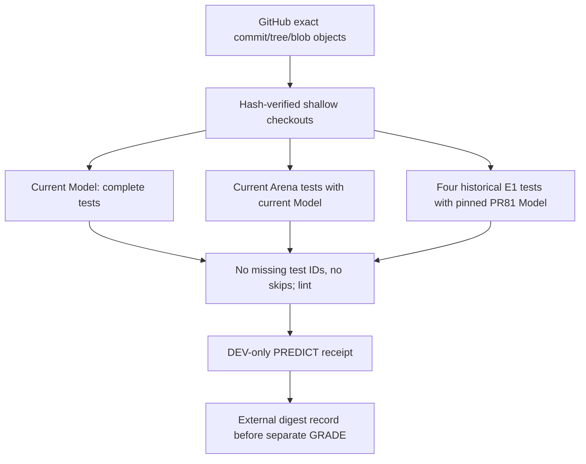
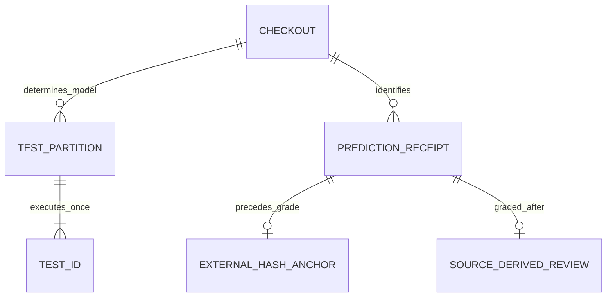

# CC-02-V2 actual execution and provenance-aware test matrix
2026-10-16 JST | #99 | IN PROGRESS, no new capability claim.

## System / change

API imports verify every original blob, tree and raw commit SHA; they are real shallow Git checkouts, not a fresh synthetic commit and not a successful `git clone`. Full history is not imported. The Git clone entrypoint itself remains untested here.

## ER / evidence

Matrix v1 records all discovered test IDs, each assigned exactly once, current/legacy interpreter and Model SHA, errors/failures/skips. It is a test-runner manifest, not a changed drawing wire schema. Historical E1 production SHA guards stay intact. Independent human annotation is still a separate unpassed gate.

## Initial experiment (before repairs)
- Current Model source `9819965c9ed1bc9f9f82af89d631482e23565a0e`, tree `a94e97217401edd8d85767a3a839e6e4afcfa823`: all 217 files verified; Model 287 tests PASS, full Ruff FAIL (2 I001).
- Arena source `031a4d1f4c4ab0dcd29c8ab529d942d461528600`, tree `e34b8667b1ddb6939508cfac9da81a717a5dfe6b`: all 98 files verified; 162 tests with current Model: 158 passed / 4 E1 errors due required historical PR81 pin. No failures are hidden as skips.
- Specified four-file Arena Ruff FAIL (7 import issues plus pairwise/redundant-int style rules). Fixed those without changing evaluation thresholds, task annotations or Model decisions.
- Python 3.12.14, uv locked render install PASS; an initial offline cache-miss attempt is retained as a failure before the successful normal sync.
- Historical Model `6d8e6399a2b0a44d08054a08b71b4a68d4d9e374` is independently reconstructed with original Git SHA/tree/blobs and locked environment.

## Decision
Repair the reproduction procedure instead of loosening historical pins. Partition all Arena test IDs between current and PR81 environments; fail on omissions, duplicates or skips. Model source repair is only two whitespace import separations with identical full Python AST. Arena arc rasterizer cleanup uses equivalent pairwise iteration and integer round result; source arc annotations/thresholds are unchanged.
No P/G/R algorithm improvement, training, confirmation scoring, real-art processing or merge. Final matrix/PREDICT/GRADE results will be appended only after actual execution. #99 remains OPEN until its independent annotation gate is also satisfied.
