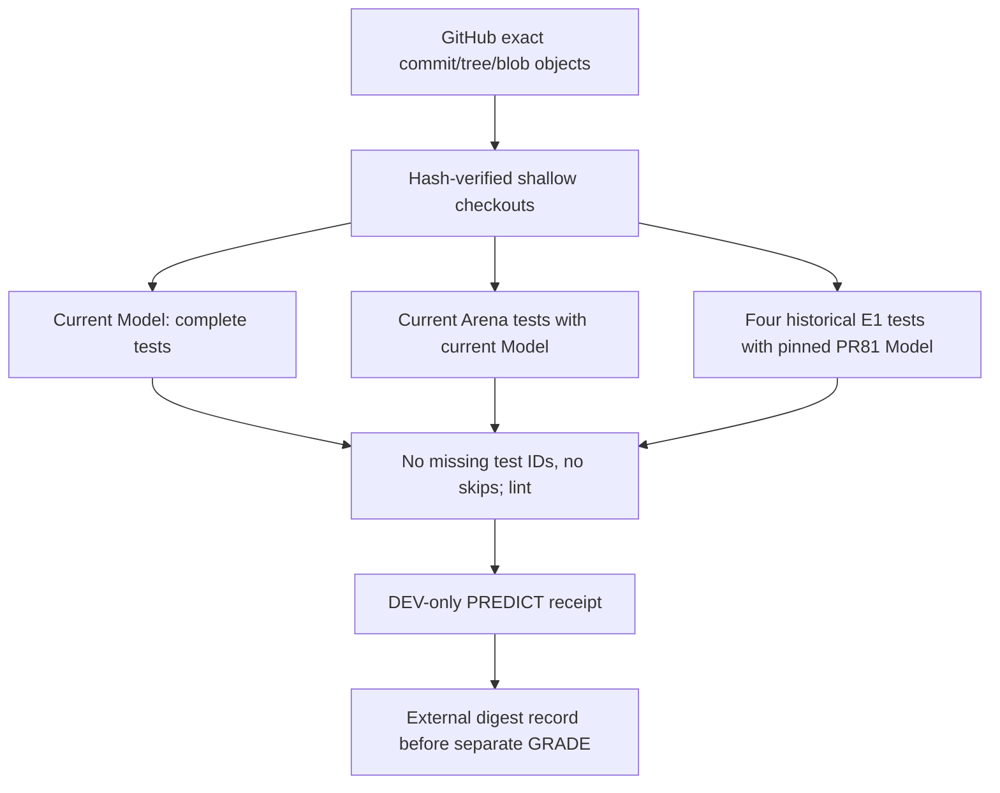
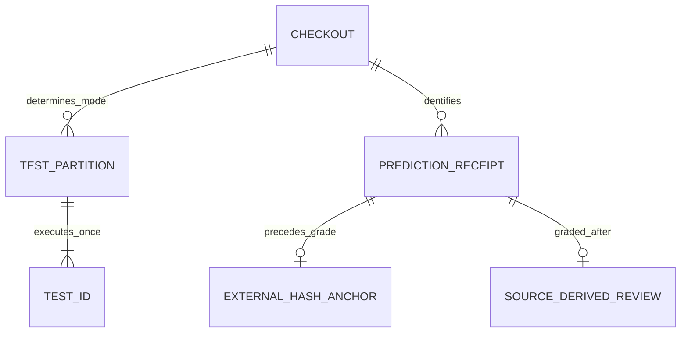

# CC-02-V2 actual execution and provenance-aware test matrix
2026-10-16 JST | #99 | SOURCE-DERIVED REPRODUCTION COMPLETE / independent annotation pending.

## System / change

API imports verify every original blob, tree and raw commit SHA; they are real shallow Git checkouts, not a fresh synthetic commit and not a successful `git clone`. Full history is not imported. The Git clone entrypoint itself remains untested here.

## ER / evidence

Matrix v1 records all discovered test IDs, each assigned exactly once, current/legacy interpreter and Model SHA, errors/failures/skips. It is a test-runner manifest, not a changed drawing wire schema. Historical E1 production SHA guards stay intact. Independent human annotation is still a separate unpassed gate.

## Initial experiment (before repairs)
- Current Model source `9819965c9ed1bc9f9f82af89d631482e23565a0e`, tree `a94e97217401edd8d85767a3a839e6e4afcfa823`: all 217 files verified; Model 287 tests PASS, full Ruff FAIL (2 I001).
- Arena source `031a4d1f4c4ab0dcd29c8ab529d942d461528600`, tree `e34b8667b1ddb6939508cfac9da81a717a5dfe6b`: all 98 files verified; 162 tests with current Model: 158 passed / 4 E1 errors due required historical PR81 pin. No failures are hidden as skips.
- Specified four-file Arena Ruff FAIL (7 import issues plus pairwise/redundant-int style rules). Fixed those without changing evaluation thresholds, task annotations or Model decisions.
- Python 3.12.14, uv locked render install PASS; an initial offline cache-miss attempt is retained as a failure before the successful normal sync.
- Historical Model `6d8e6399a2b0a44d08054a08b71b4a68d4d9e374` is independently reconstructed with original Git SHA/tree/blobs and locked environment.

## Decision
Repair the reproduction procedure instead of loosening historical pins. Partition all Arena test IDs between current and PR81 environments; fail on omissions, duplicates or skips. Model source repair is only two whitespace import separations with identical full Python AST. Arena arc rasterizer cleanup uses equivalent pairwise iteration and integer round result; source arc annotations/thresholds are unchanged.
No P/G/R algorithm improvement, training, confirmation scoring, real-art processing or merge. Final matrix/PREDICT/GRADE results will be appended only after actual execution. #99 remains OPEN until its independent annotation gate is also satisfied.

## Final executed result — 2026-10-16 JST
**Reproducible source-derived synthetic baseline PASS; full #99 independent-annotation gate remains OPEN.**

Validated code: Model `dcd46e3b3903c549d4557d9ae283ea28cdd6cbf5`, Arena `620544c1f9459f714aa8832dd9f697ed12b29400`; historical E1 Model `6d8e6399a2b0a44d08054a08b71b4a68d4d9e374`.
Python3.12.14, locked dependencies; Model 287/287 (61.669s), complete Arena ID matrix 158 current + 4 historical =162/162 (8.961s +16.165s), no skips/missing IDs. Full Model Ruff PASS; specified CC02 four files + new matrix runner Ruff PASS. Arena-wide Ruff PASS is NOT claimed. Bash syntax PASS; full clone-based shell entrypoint NOT RUN.

PREDICT produced 39 receipts from 15 public inputs. Canonical digest `1c9ce6b86a7771b1789b218616e1f6d3a34a3cfcf967d9ff96ac92a939714d3a` was [anchored on GitHub before the separate GRADE process](https://github.com/ryonakayama234/ImageProgram/issues/99#issuecomment-6203955018). Regression tests already exercise grading on temporary synthetic outputs; these are not the anchored experiment nor a blinded review. Source labels remain readable; chronology is not annotation independence.

| Arm | Correct DEV actions | Both members correct | False confident CONTINUE |
|---|---:|---:|---:|
| A1 local | 6/12 | 0/6 | 6 |
| B context | 7/12 | 1/6 | 0 |
| B-shuffle | 6/12 | 0/6 | 0 |

Controls B: 3/3. Of six intended-CONTINUE B examples:

| DEV case | Visible condition | Diagnostic | Target coverage over context candidates |
|---|---|---|---:|
| 00 | slanted | G continuation relation absent | 1.0 |
| 01 | T junction | P candidate absent | 0.0 |
| 02 | curved | G continuation relation absent | 1.0 |
| 03 | faint L8=218 | P candidate absent | 0.0 |
| 04 | parallel distractor | action-correct, actual context Edge path unobserved | 1.0 |
| 05 | Y junction | P candidate absent | 0.0 |

All 39 rows were graded, including STOP exclusions and ambiguity controls. Suspected forbidden links=0 is a candidate-graph metric, not proof that an emitted context path was correct. Historical diagnosis 3P/2G/1action is now reproduced on SHA-verified actual source with true-arc source-derived annotations; it is NOT independent adjudication or improved performance.

Wolfram exact sensitivity calculation: B vs A1 has 6 wins/5 losses among 11 discordants, two-sided binomial/McNemar p=1 under its assumptions. Even hypothetical iid 0/6 errors has one-sided95% upper bound0.393. These authored correlated DEV pairs do not support iid generalization, and this is not an inferential capability claim.

### Decision and remaining limits
- #99 reproduction/test/negative-ledger portions are executed; independent annotation remains NOT_RUN. Keep #99 OPEN and both PRs Draft.
- Do not start P/G/R tuning before the independent annotation gate. When that gate is satisfied, first #100 experiment changes weak-line evidence retention only; T/Y splitting is a separate intervention, and #101-G/R keep their fixed-input comparisons.
- Frozen Model semantics/version, all task labels/thresholds and confirmation manifest remain unchanged; Model repair is AST-identical whitespace only. No learning, new artistic ability, real-art input, Motor/Canvas optimization, Site edit, paid CI or merge.
- Full raw receipts, source-derived grades, initial failure logs, matrix IDs/logs, dependency environment and original/validated source hashes are retained in the execution evidence package, rather than described as generated-but-unsaved scratch results.

Evidence package: `cc02-v2-evidence-20261016.zip`, 49,488 bytes / 21 files; SHA256 `db04b6f9a341dcae2eba83897c605345f53d091ce75fe991e538a8ad15f0297f`. Contains all 39 public receipts/source-derived grades, initial failure and final logs, full test-ID matrix, dependency/source identity and per-file hashes. Persisted successfully; no source artwork or confirmation data is included.
