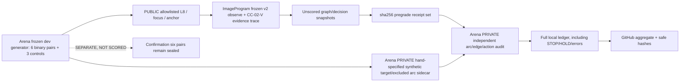
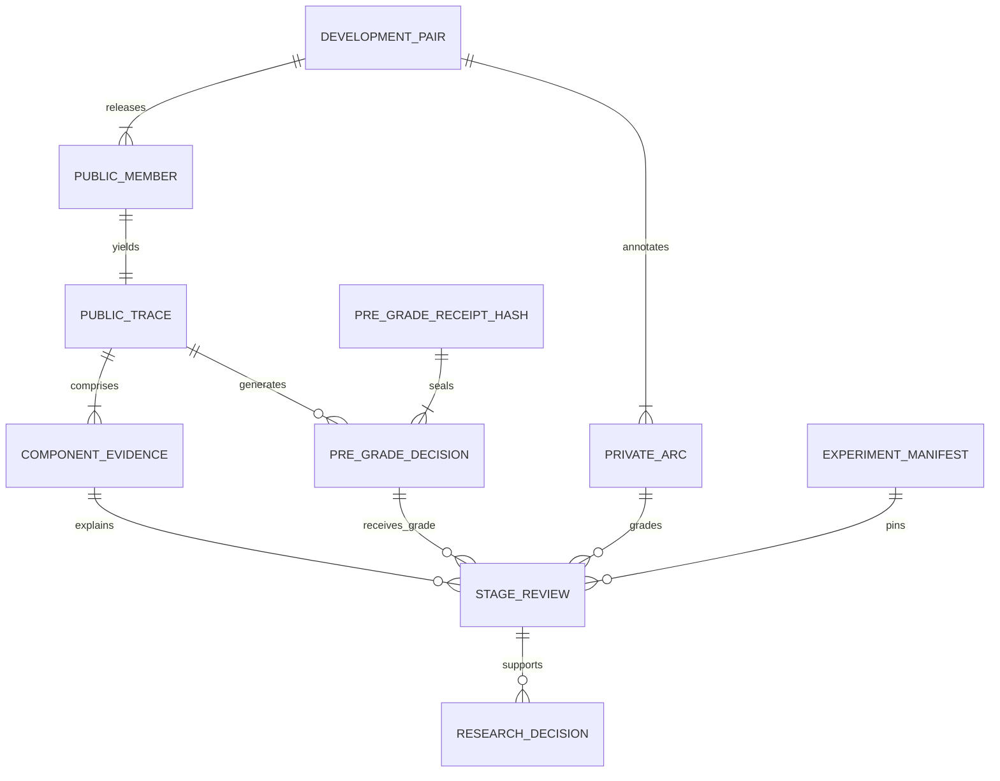

# CC-02-V-001 — Arena-private development arc audit

**2026-10-16 JST · status: IMPLEMENTED, NEVER SCORED confirmation; FULL CHECKOUT EXECUTION PENDING**

Research [Model Issue #99](https://github.com/ryonakayama234/ImageProgram/issues/99) · [Arena ADR-CC02-001](ADR_CC02_001_PERCEPTION_REASONING.md) · [Model tracing companion](https://github.com/ryonakayama234/ImageProgram/blob/research/cc02-v-diagnostics/docs/CC02_V_001_PUBLIC_TRACE.md).

Initial pinned worktree bases: ImageProgram `0f3df28b1c1c535c96db4dc05ab8d1070e649d85`; Arena `143ebc615486a4f3a86c1b675ed28f77b28d44f1`. Current Draft implementations have newer SHAs, which the runner must report using `git rev-parse HEAD`.

## Scope, constraints and validation gate

Investigate why the unchanged v2 gave B=7/12, both-correct pairs=1/6, and tentative 3 candidate miss / 2 relation miss / 1 success on the **development** split. Do NOT reinterpret old bbox-center tags as true centerline coverage. Do NOT run confirmation six pairs, modify task generator, use original art, tune v2, implement P1/R1, train Skills, optimize Canvas or merge to main. Results are not considered independently verified until full checkout run and reviewer annotation audit. A generated synthetic arc label is not equivalent to natural-art intent.

### System: the grading barrier



### ER: data v1



`PrivateArc` is Arena-only: source `member_id`, exact synthetic raster pixel positions of the target trunk (`target_xy`) and intervening distractor/branch pixels (`excluded_xy`), `status=synthetic-program-derived-single-annotation`, version. For negative members, target is empty and excluded comprises observed non-target strokes. The definitions are written from the dev generator's drawing geometry, **not inferred from v2 decisions or bbox centers**. They are not blinded human annotation and should not be described as independent adjudicated artwork annotations.

`StageReview` stores the target's exact raster-pixel retention after threshold; full admitted-component pixel coverage (zero tolerance, no tunable epsilon); target-bearing admitted node IDs; correct relation existence to the publicly observable right-hand focus component; errors at P, G, R or unknown stage; negative eligible edge proposals, holds, and original actions. The first blocker is an instrumented synthetic diagnosis, **not proof that every deeper stage is functional**. All uncertain node/edge assignment remains explicitly uncertain; v2's missing selected-edge list prevents strong R path certification.

## Data provenance and evaluation design

- Original dev generator remains unchanged. Expected manifest `4d796ebc0467153a119a233724e6f9cfc1b8509b65c77bd101c31da3a3d61dcd`; any drift aborts.
- Input: six *paired* original dev scenes: slanted, T junction, curve, weak, parallel distractor, Y branch; 12 members. Additional original three controls: ambiguity/HOLD, finite true STOP and neutral distraction.
- Frozen config: `threshold=200`, `max_gap=8`, `max_nodes=16`, `max_pixels=8192`, `max_edges=64`. Model v2 required.
- The phase-one receipts are recorded and hashed before any private arc grading. Hash is for deterministic content, excluding CPU/timing. The phase barrier is currently **in-process with a digest**, not an externally attested two-job pipeline. It must not be described as tamper-resistant oracle isolation.
- Structural controls: all A1/B/B-shuffle decisions in a member have same candidate-set SHA. No per-member labels or annotation data appear in the Model public trace or decision receipts.
- Audit both correct STOP and wrong early STOP; synthetic finite-visible ink does **not** justify stopping in real illustrations. Actual record of selected path edges remains UNKNOWN where v2 does not expose it.
- Source images/provenance from Google Drive not needed for synthetic verification. Real artworks: NOT RUN; no raw art committed.
- Sealed confirmation manifest `ce2f33f187dcb5155b3e66c85f03dd7650e3a946889064cfaeb694db4b86fd36` must not be read by the evaluator. No import of `create_confirmation_pair` in `contextual_contour_cc02_v_audit.py`.

## Executable Experiment

```bash
# Run from ImageProgram (WSL2, Python 3.12)
uv sync --locked --extra render
uv run python scripts/check.py
uv run ruff check .

# Run from ImageProgram-Arena after installing/locating paired Model checkout.
export PYTHONPATH="$PWD:$PWD/../ImageProgram/src"
python -m unittest discover -s tests -p 'test_contextual_contour_cc02.py'
python -m unittest discover -s tests -p 'test_contextual_contour_cc02_v_audit.py'
python -m adapters.imageprogram_reference.contextual_contour_cc02_pilot \
  --development --out /tmp/cc02-v2-baseline-001.json
python -m adapters.imageprogram_reference.contextual_contour_cc02_v_audit \
  --development --out /tmp/cc02-v-001-private-audit.json
```

The runner also refuses a run when either Model or Arena Git SHA is `unknown`, and includes SHA-256 of its frozen config, source modules, Model pyproject/lock (if present) and model/arena checkout heads. CPU time and wall elapsed time are measured separately from stable pre-grade receipt hashing.

**Supplemental 2026-10-16 LOCAL-MIRROR smoke, NON-AUTHORITATIVE:** On a hand-reconstructed six-positive-scene NumPy 2.3.5 probe (Python 3.13.5, *not an ImageProgram checkout*), the observed first-stage blockers were `dev-00:G`, `dev-01:P`, `dev-02:G`, `dev-03:P`, `dev-04:correct`, `dev-05:P`. Target-arc exact raster coverage by admitted components was respectively `[1,0,1,0,1,0]`. This supports only a geometry sanity check against the historical local mirror, NOT the official v2 SHA-pinned audit and not a verified independent original-art annotation. Local probe SHA-256 `d9f2dfa083cfe9126141264ff518133202152241af150a8b05e6284edeb2a0b9`, available as a conversation artifact but not as an authoritative repository runner. The official audit counts remain NOT RUN.

The runner refuses to overwrite the destination. The **unredacted** output contains private member IDs/target node matches; keep private local and do not commit. Summarize safe aggregate counts, unknown/halt, hashes, costs, Python/numpy versions, original Model+Arena SHA and all case strata in a separate experiment ledger only after execution.

### Experiment and negative ledger — as of this commit

| Claim or gate | Status | Evidence/limitation |
|---|---|---|
| Code for exact arc annotations and pre-grade receipt hash | IMPLEMENTED | `contextual_contour_cc02_v_audit.py` on Draft branch |
| Synthetic raster/geometry invariance regression tests | WRITTEN, NOT EXECUTED | `tests/test_contextual_contour_cc02_v_audit.py` |
| Full paired checkout, SHA record, all tests and Ruff | NOT RUN | Network DNS blocked in execution environment, Python 3.13.5 incompatible with Model <3.13 |
| Old local-mirror B=7/12, 3/2/1 labels | HISTORICAL, UNVERIFIED | See frozen CC02c protocol; no new counts substituted |
| New target-pixel coverage and per-stage classification on 6 positives | NOT RUN | Do not claim failure cause verified |
| Negative/hold 6 stop members + 3 controls | NOT RUN | Explicitly included by runner |
| Human two-rater/third-party annotation adjudication | NOT RUN | Only synthetic program-derived sidecar exists |
| Separate process/private oracle isolation | NOT RUN | Digest and in-process phase barrier only |
| Prospective confirmation six pairs | NOT SCORED | Must remain sealed |
| Real art, Canvas/Motor/Replay, Skill training | NOT RUN | Not within CC-02-V |

Statistical interpretation: 6 pairs are engineering diagnostics, not independent natural artwork samples. Wolfram checked the exact binomial reference `P(K>=5 | n=6,p=1/2)=7/64=0.109375`. That cannot certify generalization or identify population failure-rate confidence without source-family assumptions.

## Research decision

- **SELECT** literal public raster pixel overlap and fragment/edge evidence, plus complete baseline receipts; this corrects the older box-center proxy.
- **REJECT** relabeling a false STOP as a proven terminal or treating all admitted pixels as an adequate path: topology and competing curves still matter.
- **DEFER** implementation of P1/G1/R1 and dev Oracle arms until reproducible v2 diagnosis.
- **BLOCK** any claim that the expected 3/2/1 has been independently confirmed or that the research gate passed before the full pinned run.
- **REOPEN** CC-02-P when target pixel coverage verifies lost candidates; CC-02-G/R when admitted target candidates exist but correct edges or decisions do not; fix audit contract first if annotation/trace is inconsistent.

Every future revision of annotation or evaluator schema requires a version change, corresponding tests, updated System and ER, Experiment with full failures/HOLDs, and an updated accepted/rejected/deferred Decision entry.
