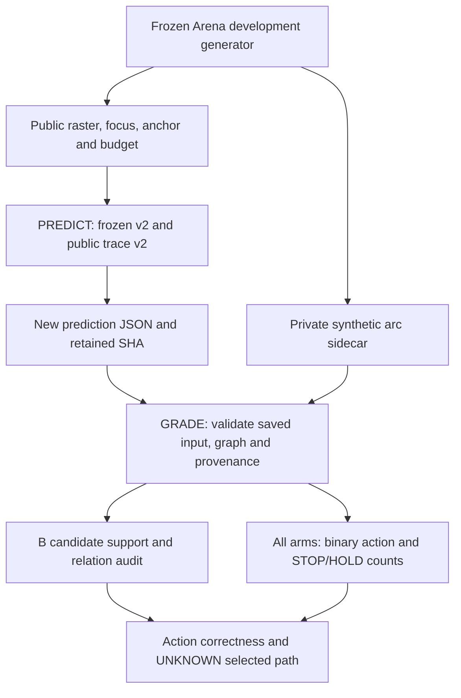
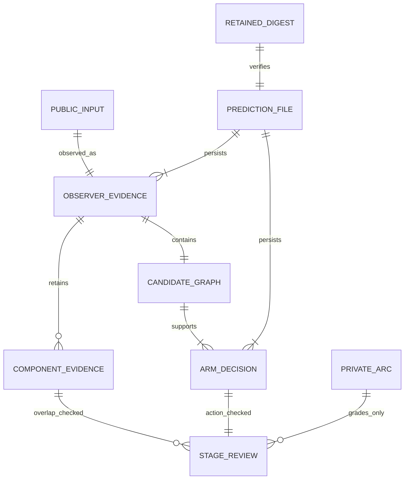

# CC-02-V review and correction — 2026-10-16

Status: diagnostic code corrected; validation ledger below. Research-only, both PRs remain Draft.
Related: Model #104, Arena #40, research #99, perception #100, reasoning #101.
This revision supersedes the v1 audit instructions; historic counts and manifests remain intact.

## Review findings and concrete corrections

| Priority | Finding / minimal counterexample | Correction and regression evidence |
|---|---|---|
| P1 | Empty 24×48 and 32×36 uint8 rasters have identical bytes, graph and old trace digest. Changing focus or budgets can also leave the digest unchanged. | Public trace v2 binds shape, dtype, focus and all observer limits. Byte-only raster SHA stays compatible with frozen tasks. Two collision regression tests. |
| P1 | G audit chose the rightmost focus node rather than the selector's actual local neighbor. Adding an unrelated focus node could change attribution without changing selection. | Audit reads B's selected local pair; absent local pair is unresolved. Extra-focus-node counterexample regression. A1/shuffle actions remain scored but receive no B-stage attribution. |
| P1 | Full target coverage alone can include excluded branch pixels; binary CONTINUE correctness was counted as an unqualified successful stage. | Excluded-only support contamination is measured, shared junction pixels reported separately, contaminated target ownership remains unresolved. Every selected path verdict remains UNKNOWN; positive binary success is action-correct-path-unverified. Two regressions. |
| P2 | v1 documented only an in-process prediction hash; there was no saved-input grading path to replay the same decisions. | Separate PREDICT/GRADE CLI processes; complete public traces and input identity saved before grading. Mandatory retained prediction digest; grading does not call observer/selector. Mutated digest, wrong order/count/config/source/shape/graph and exclusive-write regressions. This is integrity and chronological evidence, not a security sandbox or independent annotator. |
| P2 | Model full Ruff fails two inherited import findings; new Arena files also have import findings. A monolithic Arena run uses current Model for four PR81-only tests and fails. | Formatting-only fixes; full frozen-observer Python AST equality checked. Matrix runner preserves real historical PR81, checks discovery against exact executed IDs, and rejects skips/duplicates/omissions. |

Neither P/G/R algorithm, fixed task labels, original generator, production contract nor confirmation manifest was changed. The original observer file has one blank-line change only.

## System: saved predictions, private grading and unknown paths



Grading reconstructs public data from the saved trace; it does not run fresh model predictions. PREDICT still invokes a trusted synthetic factory whose implementation contains private labels; only its public allowlist reaches Model. This is not process-level secret isolation from malicious Python. The canonical prediction digest includes runtime/provenance, so differs across runs; the inner receipt digest is deterministic for fixed code/inputs. The operator must retain the printed canonical digest before GRADE; supplying a newly computed digest after modifying a file defeats external anchoring.

## ER and research schema v2



- Public trace: `cc02-v-public-trace-v2`; adds shape/focus/max_gap/max_nodes/max_pixels to public digest. Input dtype is always uint8 under frozen observer validation.
- Arena audit/PrivateArc record version: `arena-cc02-v-arc-audit-v2`; arc coordinates unchanged. These are additive research records, not P1/P2 or new learned models.
- Prediction: 15 public input identities, 15 full public traces, 45 arm decisions, graph/trace/receipt hashes, source/lock/config SHA, Python/NumPy, both Git heads, dirty flags, separate wall/CPU times.
- StageReview: target coverage, threshold survival, target-bearing IDs, excluded-only contamination, shared junction pixels, B's actual local-pair relation, binary correctness, path UNKNOWN. Annotation is **single-author, program-derived**, not blinded independent annotation.
- Earliest blocker describes observed insufficiency. No intervention was made, so it does not prove that replacing that stage alone would fix the task.

## Experiment ledger

Complete trees were fetched through authorized GitHub Git Data API, each blob SHA and full root tree verified, original commit objects reconstructed and verified, and clean shallow checkouts created. Successful `git clone`, full history and WSL2 are not claimed. Python 3.12.14; locked NumPy 2.5.3, Pillow 12.3.0, Pydantic 2.13.5, Ruff 0.16.7; CPU execution, no paid CI.

Original inspected heads: Model `401c0ef14472769113939e64a743958afd64bd1d`; Arena `152fa16b483821a733afb7f84ce6e2009f1c5915`. Original Model 291 tests PASS; full Ruff failed 2 import findings. Original Arena 155 discovered: 151 PASS and 4 historical PR81 mismatch errors. All these failures are preserved in the evidence package; they were not skipped or relabeled PASS.

- Final Model: **293/293 tests PASS**, zero skips; full Model Ruff PASS. The initial post-change Ruff run caught one test import grouping issue, fixed as formatting only; final full Ruff passed.
- Final Arena discovery matrix: **159 current + 4 exact PR81 = 163/163 PASS**, zero skips, exact ID coverage. A final repeat after the real-raster extra-focus regression is recorded separately. Historical checkout is `6d8e6399a2b0a44d08054a08b71b4a68d4d9e374`; its pin is never monkeypatched.
- Changed Arena audit/test/matrix files: Ruff PASS under explicit Model lint policy; Arena-wide lint is not claimed.
- New/updated focused checks: Model trace 6 + Arena audit 14 = **20 PASS**. Three minimal counterexamples were also executed against the original functions: extra-focus relation false→true, contaminated support old `correct`→`target-ownership-unresolved`, shape-different digest equality true→false.
- Formal standalone saved PREDICT→retained digest→separate GRADE receipt is recorded in the subsequent evidence addendum. Until that addendum, counts below describe the reproduced baseline and integration checks, not an externally anchored new run.


### All development strata, B arm (source-derived annotation)

| Scene | Target admitted coverage | Threshold survival | Binary B action on continue / stop | Earliest observed positive insufficiency |
|---|---:|---:|---|---|
| Slanted successor | 100% | 100% | STOP / STOP | G relation absent |
| T junction | 0% | 100% | STOP / STOP | P component rejected |
| Curved successor | 100% | 100% | STOP / STOP | G relation absent |
| Low contrast | 0% | 0% | STOP / STOP | P threshold loss |
| Parallel distractor | 100% | 100% | CONTINUE / STOP | Binary action correct; selected path UNKNOWN |
| Y branch | 0% | 100% | STOP / STOP | P component rejected |

A1: 6/12 members, 0/6 both-correct pairs, 6 false CONTINUE, 0 HOLD.
B: 7/12 members, 1/6 both-correct pairs, 0 false CONTINUE, 0 HOLD.
B-shuffle: 6/12 members, 0/6 both-correct pairs, 0 false CONTINUE, 0 HOLD.
All three B controls correct: ambiguous HOLD, finite-visible true STOP, neutral-context STOP (3/3).
There are 5 premature B STOPs among 6 positive members. No selected target path or drawn result is certified.

Across the six paired families, B vs A1 has only one discordant pair-level success. Wolfram exact two-sided sign reference is p=1; five-or-more successes out of six fair Bernoulli trials is 7/64. These calculations do not establish a population model, independent artwork samples or generalization. Source-derived P=3/G=2/action-correct=1 is reproducible here, while blind annotation and causal rescue remain unverified.

### Executable rerun

```bash
# Model: locked Python 3.12, includes all model tests
uv sync --locked --extra render
uv run python scripts/check.py
uv run ruff check .

# Arena: current Model plus separate exact PR81 checkout, each with locked .venv
../ImageProgram/.venv/bin/python scripts/check_cc02_v_matrix.py \
  --model ../ImageProgram --historical-model ../ModelPR81 --out /tmp/cc02-v-matrix-new
# Explicit shared lint policy for the three changed Arena Python files
../ImageProgram/.venv/bin/ruff check --config ../ImageProgram/pyproject.toml \
  adapters/imageprogram_reference/contextual_contour_cc02_v_audit.py \
  tests/test_contextual_contour_cc02_v_audit.py scripts/check_cc02_v_matrix.py
export PYTHONPATH="$PWD:$PWD/../ImageProgram/src"
../ImageProgram/.venv/bin/python -m adapters.imageprogram_reference.contextual_contour_cc02_v_audit \
  --development --phase predict --out /tmp/cc02-v-prediction-new.json
# Retain the canonical sha256 printed above BEFORE the next command.
../ImageProgram/.venv/bin/python -m adapters.imageprogram_reference.contextual_contour_cc02_v_audit \
  --development --phase grade --prediction /tmp/cc02-v-prediction-new.json \
  --expected-prediction-sha256 RETAINED_CANONICAL_SHA --out /tmp/cc02-v-grade-new.json
```

The old `--development --out` command without `--phase` is intentionally rejected. The Python `run_development_audit()` wrapper is an explicitly marked in-process integration check, not the formal saved evidence path. Arena-wide lint is not claimed.

Development manifest remains `4d796ebc0467153a119a233724e6f9cfc1b8509b65c77bd101c31da3a3d61dcd`. Original confirmation manifest remains `ce2f33f187dcb5155b3e66c85f03dd7650e3a946889064cfaeb694db4b86fd36`; no confirmation model inference. Real artworks, Canvas/Motor/Replay optimization, training and merges NOT RUN.

## Research backlog: capabilities and falsifiable next questions

| ID / priority | Capability question and hypothesis | Isolated test / evidence that would refute it | Why it matters for drawing |
|---|---|---|---|
| CC-02-P / #100 | Can T/Y branch evidence survive as competing path hypotheses without automatically assigning target ownership? | Fixed binary tasks plus predeclared branch/distractor controls; measure exact target coverage AND excluded support, candidate count and cost. Coverage gains accompanied by forbidden joins do not pass. Existing P01 weak-bank work remains a separate experiment and must not be counted as solving branches. | Retain a usable intended line without making one tangled stroke. |
| CC-02-G / #101 | On identical frozen admitted Fragments, can endpoint-role/local-tangent relation evidence recover the slanted and curved successors? | G0/G1 on the SAME Fragment set, with parallel/crossing distractors and same budgets. Report eligible true and false edges; improvements from changing P cannot be called pure G effects. | Connect the intended curve, rather than merely nearby marks. |
| CC-02-R / #101 | Can a versioned path decision distinguish positive terminal evidence from missing/weak evidence and return explicit ordered node/edge IDs? | R0/R1 on identical Relation graphs; annotated terminal, missing-candidate, ambiguous and distractor cases. Track false STOP, false join and HOLD, not accuracy alone. Confirm actual path support, never infer it from CONTINUE. | Choose a line and know when to stop or inspect again. |
| CC-02-V annotation gate / #99 | Do independent reviewers agree about target/excluded arc and true termination on authorized unseen source families? | Blind annotations before predictions, disagreements adjudicated or UNKNOWN, original art private. Synthetic source-derived agreement is not a substitute. | Prevent generator conventions from becoming assumed artistic intent. |
| CC-03-DRAW / deferred | Can an evidence-linked path become one coherent stroke within an action/ink budget, without patching over position errors? | Once path and annotation gates pass: fit→Motor→Canvas→Replay; evaluate target coverage, forbidden ink, endpoint/tangent continuity, stroke/pen-lift count, replay validity and cost separately. Geometric improvement with more dirty overdraw fails the integrity objective. | A coherent reusable drawing action, then transfer across brush/scale; not pixel matching alone. |

## Decision and release boundary

SELECT: fix the diagnostic and evidence contracts, preserve exact frozen decisions, publish negative findings and research gates. REJECT: certify target ownership from coverage or path success from binary action, silently relax historical pins, overwrite previous receipts, or read sealed confirmation for convenience. DEFER: production P/G/R changes, human annotation collection, end-to-end skill learning and full drawing optimization. REOPEN each capability only under the isolated tests above.

Both PRs stay Draft. #99 remains OPEN: source-derived synthetic diagnosis is now testable, but independent annotation, actual selected Edge-path evidence and real-art transfer are not completed. System, ER, this experiment ledger and Decision are updated together; older documents remain history with an explicit supersession pointer.
