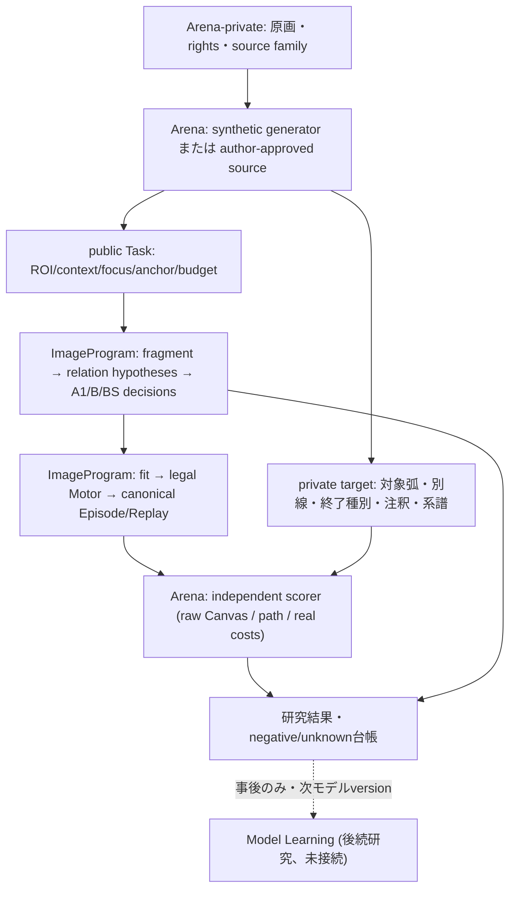
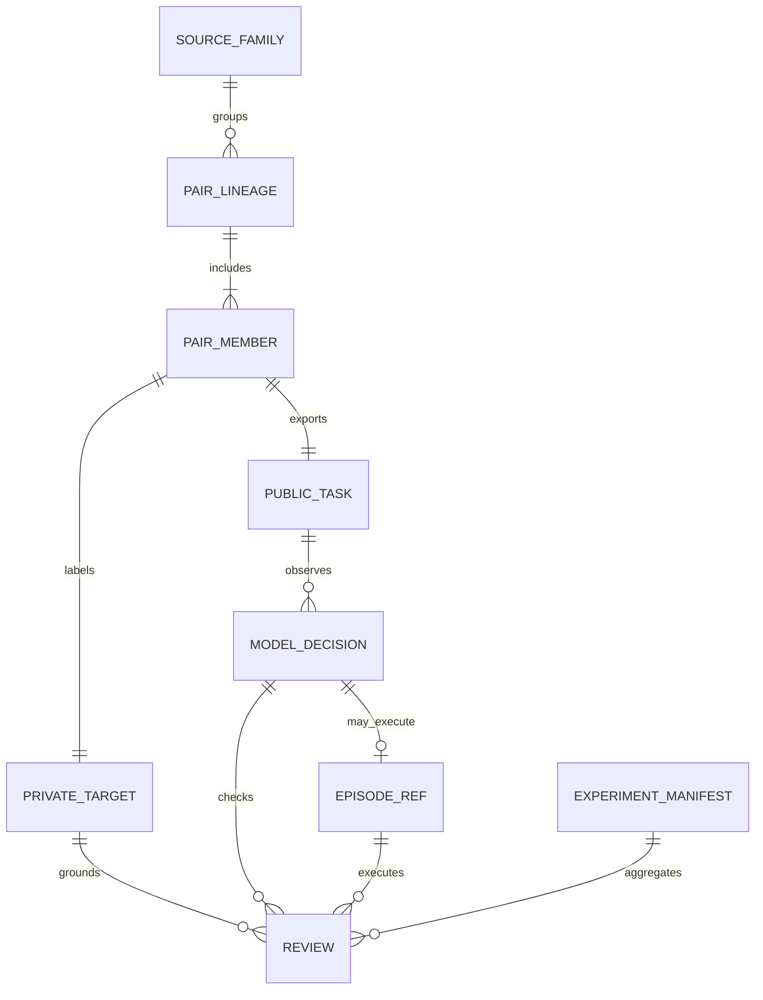

# CC-00 / ImageProgram #96 — ContextualContour 独立評価契約・実験記録
2026-10-14 JST | `arena-contextual-contour-cc00-v0` | **設計のみ**（新規Canvas評価・新規認識実験は未実施）

親: [Model #96](https://github.com/ryonakayama234/ImageProgram/issues/96)
対向文書: ImageProgram `docs/CONTEXTUAL_CONTOUR_CC00_EXECUTION.md` on `research/contextual-contour-cc00`
既存draft基準: Model #95 `af0c24f53312412ad7e2828482333c17af1a0eab`、Arena #35 `b493e77e54acb6b6e42366191ba738b8c3bcef34`。
既存の8 ROIは同一source-familyのdevelopment。観測3/8、短いsmooth描画1件、target/appearanceはunknown。新実験の独立confirm結果と混同しない。

## 1. System — 誰が正解を知るか



Arena owns immutable source/annotation/split and evaluator implementation. It must **not** import Model predicted path, model scorer, or candidate score as reference truth. Model must not see private label, source-global metadata, rights/private file identifiers or exhaustive oracle outcomes while deciding. Experiment diagnostics may link public hashes to a private manifest after inference ends.

## 2. Data — proposed reviewer-owned records (not canonical implemented wire)



- `PairLineage`: `pair_id, source_family_id, template_family_id, split, seed, local_observation_digest, intervention_description, member_ids`. Both pair members belong to same split; derived crops/augments never cross split.
- `PairMember.public`: `public_task_digest, local_focus_digest, permitted_context, anchor, candidate_set_digest, budget, placement_ref`. No private fields in task JSON; validate explicit allowlist, not merely blacklist.
- `PrivateTarget`: `target_arc/polyline, excluded_line_ids, acceptable_endpoints, label{continue,stop,ambiguous}, allowed_tolerance, annotation_version, source_private_digest, source_family_id`. The private dataset may store geometry for metrics, never pass it to model.
- `DecisionReceipt`: `arm, candidate_set_sha256, config_sha256, decision_sha256, chosen ids, action, status, reason, observed_inputs, cost`. Snapshot it before any world execution. A1/B candidate-set equality checks occur pre-execution. Missing result cannot silently disappear.
- `Review`: `target_coverage_arc_length, off_target_path_fraction, forbidden_join_count, terminal_correct, appearance_assessment, legal_motor, replay_verified, protected_ink, unknown_reason, evaluator_version, source_immutability_checked`.
- `ExperimentManifest`: `model_sha, arena_sha, task_lineage, split_manifest_digest, evaluator_version, tool/body/transform_versions, config_digest, seeds, public_artifact_digests, outcomes, statuses, cost`. Public summary strips private absolute locations and raw original images.

Missing decisions and unsupported widths are distinct status values. Held/unknown cases remain in the denominator for answerable tasks; ambiguous items are reported separately. Do not calculate labels from the Model-selected path.

## 3. Experimental invariants / fail closed

1. Before any inference: permissions verified, dataset family partition and private truth fixed, annotated ambiguous cases explicitly marked. Synthetic pair must have **bytewise-equal local-only observable input**, including candidate order/anchor/local budget/seeds, and opposite correct actions. Otherwise `invalid_pair` and exclude from valid evaluation with count retained.
2. A1 and B get **the same permitted full public raster**, but A1's selector uses local-only features; B's selector can use relation evidence. Same candidate set ID/hash and bounded search/observation budget. B's extra compute is recorded, not treated as free.
3. A0 is historical prior extractor and is *not* an ablation proof. B-shuffle breaks relation-to-candidate correspondence and is a diagnostic only, not independent task or natural score.
4. Add non-adversarial **context-neutral** control where peripheral features change but intended action does not; **misleading-neighbor** control where visually close but distinct branches tempt a false join; **true-stop** and **ambiguity/hold** controls. The original 6+6 opposite-label pairs are necessary but insufficient for realistic transfer claim.
5. Frozen confirmation data cannot tune thresholds, configs, feature choice or admissibility after scores are seen. A revised method gets new version and a new confirmation family.
6. Independent scorer checks target coverage in **original source/ROI arc coordinates**, contamination fraction, exact excluded joins, endpoint kind, and extra boundary ink; then separately Canvas geometry, line quality, legal Motor, Replay and protection.
7. Public `program_exhausted` does not mean task completed; a detected path that stops at `fit` is an observation-vs-fit distinction, not a full artist success.
8. Snapshot/artifact hashes and dependency Model/Arena SHAs are required for an authoritative result. `0 required skips`; paid CI must not be run without explicit approval.

## 4. Gate and actual experiment ledger

| ID | Primary question | Split | Actual result | Status | Decision |
|---|---|---|---|---|---|
| CC-00 | local-only deterministic classifier can solve opposite-label pair? | exact toy / no raster | logical enumeration says no | **theoretical diagnostic only** | retain pair test, add controls |
| CC-01-dev | does candidate generation retain thin/branch candidates and B select correct relation? | 6 development pairs, same local evidence | none | planned/not-run | pre-register target first |
| CC-01-confirm | is 5/6 both-member correct met under frozen protocol? | 6 new template-family pairs | none | planned/not-run | no tune on held-out |
| CC-01-real | is chosen path actually drawable and visually valid? | representative 3 from existing 8 ROI | none | planned/not-run | true Canvas comparison |
| CC-01-transfer | does a relation policy transfer across work/source family? | 6+ segments, unseen family | none | dataset missing | transfer = unknown |

Original provisional selection-only engineering gate: at least 5/6 confirmation pairs both members correct, >=2 pairs over A1, forbidden joins 0 in stop/distinct controls. It is not a hypothesis test or evidence of skill learning. A1 on intentionally identical local oppositely-labeled pairs is **guaranteed** to fail both-correct, so the margin is a weak primary indicator by itself; report individual accuracy, confusion matrix, risk vs coverage, non-adversarial controls, family stratification and budget.

Real Canvas gate separate: >=90% independent target arc coverage, <=5% off-target path, forbidden join count 0, plus legitimate shape/appearance, zero illegal protected ink, no unexpected replay mismatch. Width/medium unsupported must not be silently filtered.

## 5. CC-00 experiment evidence and judgment

Wolfram Language exact enumeration (2026-10-14):
```wl
Table[Boole[a == 0 && a == 1], {a, {0, 1}}]
(* {0,0} *)
Max@Table[Boole[a == 0] + Boole[a == 1], {a, {0, 1}}]
(* 1 *)
Sum[Binomial[6,k]/2^6,{k,5,6}]
(* 7/64; only under a hypothetical independent 1/2 per-pair null *)
```
This is a proof about experimental identifiability, **not** a new ImageProgram perception result, Arena simulator run or statistical p-value for the proposed gate.

**Conclusion**: the collision-pair construction can test whether available peripheral evidence is used; it cannot alone justify claims about natural drawing intelligence. First deliverable for CC-01 is independent labels and split-frozen manifests, then code. Do not confuse human annotations / Drive image inspection with Model's own eye.

### Failure classes
`intake_invalid`, `invalid_pair`, `candidate_missing`, `wrong_target`, `false_join`, `premature_stop`, `unjustified_continue`, `unknown`, `ambiguous`, `fit_failure`, `compile_failure`, `motor_failure`, `replay_mismatch`, `appearance_unsupported`, `budget_exceeded`, `evaluator_failure`.

### Follow-up / review
For every CC-01 experiment PR, update the system flow, ER/field version, changed test contract, full failed and held outcomes, and next decision **together**. Keep all original art/private annotations/private episodes local; git contains hashes and safe statistical summaries. Do not merge or mark PASS on the basis of this CC-00 planning-only PR.

## CC-01 follow-through (2026-10-14)
New independent record: [CC-01 synthetic pair generator, evaluator, System/ER and result ledger](CONTEXTUAL_CONTOUR_CC01_RESULTS.md). Rotation probe is correlated and is NOT independent confirmation; Canvas/Replay remains not-run.
