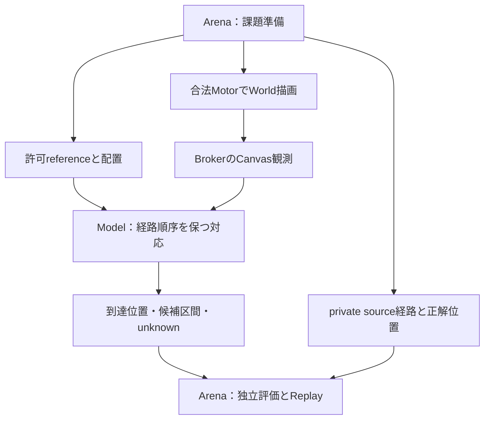

# 一本の曲線の到達位置：v0検証記録

結果は観測専用prototypeの研究記録。Modelの昇格、人間による作品評価、学習済み技能、実作品への一般化を意味しない。Model Draft #86とArena Draft #30の上に積む変更。

## 今回確かめた問い

許可済みreference ROIと真正Canvas観測だけから、一本の開いた細線の実インク端がreferenceのどの位置に対応するかを測る。生成Program、制作fraction、Motor指示終点、private評価ラベルは測定関数に渡さない。公開pen poseも推定には使わない。



privateラベルは準備／事後評価に限定。測定はWorldを変更せず、補筆は実行しない。

## コード固定と受入れ条件

未使用群の実行前に以下のコードと設定を固定。検証後の追加変更はこの記録のみ。

|対象|検証したGit commit|
|---|---|
|ImageProgram|`56caed13aeed4b6b70c05b1373b8188a143517fe`|
|ImageProgram-Arena|`7eb658b74863ea04ecdf5238f916b961e53aa1d0`|

測定設定：sample間隔1 World px、対応許容2px、到達候補区間幅4px以下、局所曲線被覆の終端許容2px。受入れは支持範囲の測定率90%以上、測定できた全支持例の独立source弧長誤差2px以内、否定例／白紙の誤完成ゼロ。

実装file SHA256：

- Model observer：`ea9bb4d8de973bfc5fcbff0cc0e81ce25435c7555223444e7b15a6ed455e66c9`
- Arena benchmark：`329976cb973da64b6122f975e5f5495409a36af7b1228edfaa33bc12a688efdc`

## 測定方法

参照／観測の全インクについて、一本の開いた分岐のない経路か確認。参照の中心線を細かい折れ線にし、既存placementでWorldへ写像する。観測の細線化で端が縮む場合は、半径4pxかつ終端方向の横幅1.25px内の実インクからfrontierを回復する。これは今回の1px pen向けのインク境界推定で、物理筆先位置ではない。

全観測経路と参照の先頭部分を、離散Fréchetの順序保存対応で比較する。両向きを試し、対応方向と狭い候補区間が一つに定まるときだけ`measured`にする。候補幅は幾何上の許容区間で、校正された確率ではない。参照の向きは端点の辞書順であり、作者の筆順を認識したとはしない。

独立評価では、**返された対応点をArenaのprivate analytic source折れ線に投影**し、そのsource弧長を既知の制作位置と比較する。Model抽出経路を正解には使わない。reference raster由来の推定弧長とanalytic source弧長は総延長が異なるため、差を別々に記録する。

## 固定コードでの結果

|群|期待状態の判定|支持例の測定|対応点をsource経路に投影した最大弧長誤差|raw推定弧長とsource弧長の最大差|
|---|---:|---:|---:|---:|
|開発|54/54|46/46|1.413 World px|5.087 World px|
|未使用の2曲線family|12/12|10/10|1.023 World px|4.442 World px|

2px以内という結果は**対応位置のsource上の誤差**である。raw弧長値／完成率の数値自体の誤差が2px以内という主張はしない。分母となるreference総延長にはラスタ化／中心線化の影響が残る。

開発54条件の内訳：4 Bezier family×6到達状態＝24、U curveの5到達状態、水平／垂直の位置違いと5到達状態＝20、穴・終点だけ・分岐・閉経路の否定例4、near-self反例1。支持例46は非白紙の曲線25＋直線20＋順序対応反例1。残りは白紙4と否定例4。

未使用12条件は、新しいBezier制御点の2 family×6状態（0/25/45/65/85/100%）。白紙2、非白紙10。開発結果を読んだ後、固定コードのまま実行した。reserved開始には開発54/54、source commit・file fingerprint・設定hashの一致を要求する。2 familyの各途中状態は相関のある反復であり、12個の独立した実作品ではない。統計的な一般化は未証明。

全66状態で合法P1実行とReplayを確認し、測定したframeとcanonical final rasterが一致。測定前後のWorld hash不変、測定中Motor 0、保護外着墨0。

### 終点だけを見ると誤る具体例

near-self例の実際の準備弧長は45.000px。終点だけを全referenceの最近点に対応すると297.511pxまで描けたように飛ぶ。全観測線の順序を保つ対応では45.925pxを返し、独立source誤差0.925px。これは一つの人工反例での確認で、最近点法に対する広範な優位性を証明しない。

### 以前停止したcoarse曲線

元のDraft #86実装で記録した38 transitionのepisodeを元の実装でReplayし、検証成功。新しい固定実装で同じ合法Motorを再実行し、元の最終rasterと完全一致、再度canonical Replayも成功した。そのCanvasだけを観測すると：

|設定|判定|理由|
|---|---|---|
|今回の固定許容2px|`unknown`|`no-order-preserving-prefix-match`、最小対応誤差3.702px|
|許容4pxの診断のみ|`unknown`|`ambiguous-reference-progress`、到達候補93.927～100.922px、幅6.995px|

4px診断は固定受入れ設定ではなく、この例をPASSに変更していない。旧経路の粗い折れ線化による参照との不一致が残る。unknownの候補は描画指示として使用しない。このlegacy例は54/54、12/12の分母に入れていない。

## 開発中の失敗と修正

初回pilotは53/54で、hair_curveの80%がsource弧長誤差2.919px。細線化で実インク端が削られる影響を確認し、上記の固定範囲frontier回復を追加した。次のpilotは54/54。その後Gitコードを固定し、開発群54/54を再実行してから未使用群12/12を実行した。pilotを固定コードの証拠と混ぜない。

## 回帰チェックと環境

- Model全unittest：260/260 PASS、64.080s。新規観測test12は人工pixel／幾何fixtureであり、World証拠は上の66状態。
- Arena全unittest：129/129 PASS、17.125s。新規benchmark test3を含む。既存cross-repo baseline契約を維持するためArenaの全testは元の#81 baseline interpreterで実行した。新規benchmark本体は新しいModel interpreterで実行した。
- Model全Ruff PASS。Arena新規Python 2fileは`E4,E7,E9,F,I` PASS。Arena親に残る既存の全体lint問題9件は今回修正せず、全Arena Ruff PASSとはしない。
- Python 3.12.14、NumPy 2.5.3、Pillow 12.3.0、Pydantic 2.13.5、pydantic-core 2.46.5、Ruff 0.16.7。
- 新worktreeの`uv sync --locked --extra render --offline`はRuff wheel cache欠落で失敗。既存のlockに対応したModel venvを複製しeditable import先を新worktreeへ更新、バージョンとimport先を確認して実行した。sync成功とは扱わない。

開発実行：

```bash
# 固定commitのcleanなArena worktree内。新しいModel interpreterを使う。
../ImageProgram-CurveProgress/.venv/bin/python -m adapters.imageprogram_reference.curve_progress_benchmark_v0 \
  --split development --out runs/curve-progress-development-frozen-20261013
../ImageProgram-CurveProgress/.venv/bin/python -m adapters.imageprogram_reference.curve_progress_benchmark_v0 \
  --split reserved \
  --development-report runs/curve-progress-development-frozen-20261013/report.json \
  --out runs/curve-progress-reserved-frozen-20261013
```

再実行時は同名出力が存在しないディレクトリを使う。記録docsを追加したbranch先端ではなく、上記の固定code commitをcheckoutする。private構成と個々の生成task、episode、private評価ラベルはignored `runs/`に保存し、Gitへは本集計記録のみ追加。raw結果はwall time等を含むため再実行時にbyte hashが一致するとは要求しない。

記録したreport SHA256：

- 開発：`81f8c28afc9b69ffa1f404e9c48b90b66694103ad2e5260f7aae510cc985ed7b`
- 未使用群：`72d8ddf097123e1039ea4b8f27e182688c9e235133b8b8ea98fd6c210234a911`

実行前に保存したprivate configuration SHA256：

- 開発：`21c1f0f3a869ac9dc984a379213de6c77eaa43802ff996e77b557a98a2507db8`
- 未使用群：`d61bc6a7dd985a990d3d69b89293d6064243d67fb99917ce4dff6a9a7844e780`

## 次の能力に進む境界

まず旧coarse曲線の参照／描画経路ずれを保ったまま「どの観測なら対応を確定できるか」を改善する。到達点を確定できた例に限って、次の独立能力として「到達点から先の補筆候補を作り、評価して描く」を検証する。実作品ROI境界、複数線、交差、筆幅違い、参照なし創作、経験からの学習／技能転移は今回の支持範囲外。
