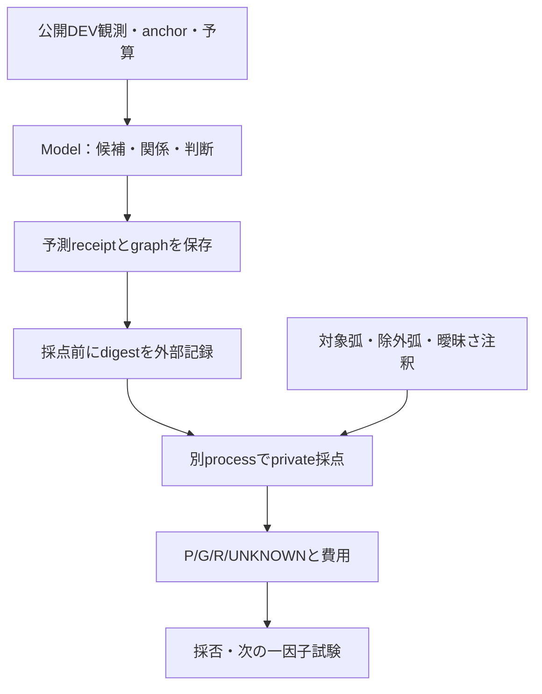
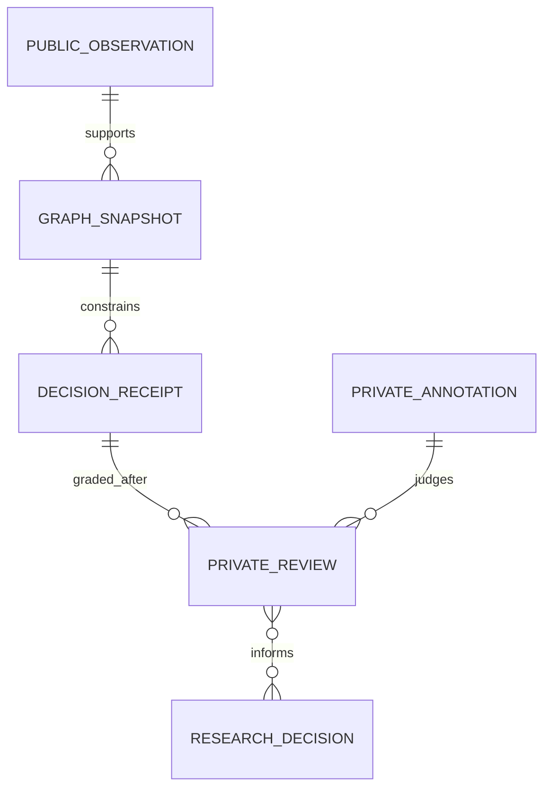

# 次の能力の独立評価・作業案 — 2026-10-16
Status: PROPOSED / documentation only. Search: NEXT-CAPABILITY-20261016, CC-02-V2, contextual-contour, relational-transfer.
Model counterpart: [能力・全体System・データ・作業案](https://github.com/ryonakayama234/ImageProgram/blob/research/cc02-v1-arc-audit-20261015/docs/NEXT_CAPABILITY_20261016.md)。
Parent: [Model #96](https://github.com/ryonakayama234/ImageProgram/issues/96) / current operational gate [#99](https://github.com/ryonakayama234/ImageProgram/issues/99)。

## Decision
次の能力目標は「周辺の証拠から、どの可視輪郭を描き、どこで止め、いつ保留するか選ぶ」。
次の一作業は既存V2の固定SHA再現・全DEV評価・独立注釈確認。評価基盤の追加自体を能力向上としない。
次の能力変更は#100の弱線候補保持のみを最初の一因子試験とし、その後T/Y分岐分割を別試験にする。
固定Fragmentで#101-G、固定Relationと順序付きEdgeの出力検証後に#101-R。P/G/Rを同時改変しない。
小さなまとまりを周辺との関係を保って別配置へ描き直し、将来Skillとして再利用することは上位目標であり未着手。

## System

既存v2では真の選択context Edge pathは未観測。CONTINUE行動正答だけで対象経路正答を主張しない。
P変更はG入力も変える。G比較は同じFragment、R比較は同じRelationで行う。

## ER / Data

概念図。新しいschemaを実装済みという意味ではない。既存V2契約を用いる。
必須記録はsource lineage/split、公開入力hash、Model/Arena実Git SHA、候補/関係hash、固定設定、予算、行動、対象弧被覆、除外弧混入、疑わしい関係と実際の誤CONTINUEの区別、STOP/HOLD、unknown、費用、レビューの独立性。
元画像の別ROI・変形兄弟を学習/確認の独立例として分割しない。

## Experiment / actual scope this turn
参照点: Model `fc60272805d3ae5228abc13290c89c0099d56d0c`、Arena `0dcaca632a15da2a14d134e0326b03b8769e3dcc`。
歴史的V1: B action 7/12（always STOP 6/12）、CONTINUE 1/6、暫定3P/2G/1action-path-unobservable。
V2: 15公開入力・39予測行が期待値であり、今回生成した件数ではない。全suite/Ruff・実checkout再現・V2採点・独立注釈は未完了。
今回direct git probeは認証失敗（Usernameを読めない）で、DNS失敗とは区別する。
今回行ったのはIssue/PR/仕様の確認、研究者による添付4画像の観察、Sites教材室の存在確認、作業案の文書化。
新P/G/R実装・能力実測・Skill学習・confirmation採点・実作品描画・Site編集・mergeはNOT RUN。

## Gates / failure response
1. #99: 現行HEADを実行時に固定し、既存再現scriptを使い、39予測receiptを採点前に外部記録、別processでgrade。差異/欠落/skip/UNKNOWNを明示。
2. source由来の合成注釈と、予測を見ていない独立した注釈判定を区別する。独立性を確保できない段階では#99全体をPASSにしない。
3. 最初のP比較: 候補残存だけでなく偽候補・禁止弧混入・時間/候補数を併記。既存開発6例中5例基準を実作品汎化や母集団保証としない。
4. 文脈比較: 局所同一・周辺相違を用い、公開観測が同一で正解だけ違う例は不可識別として分離。A1/C/Bと対応破壊対照を比較。単純Cと同等なら複雑なRを増やさない選択を残す。
5. 設定凍結まで既存confirmation6対は未採点のまま。実作品とMotor/Canvas/Replayは経路gate後に別成績で検証。
6. 将来の経験学習はSkill有無で未使用構成の品質/探索/総運動費用を比較。手書き規則の改善と自主学習を混同しない。

各単位で同じ研究IDにSystem / ER-Data / 全Experiment / 採否と再開条件を保存する。
既存[二段階再現protocol](CC02_V2_TWO_PHASE_REPRO.md)は維持。本提案は能力目標を説明する追補であり、既存gateの緩和・達成・merge許可ではない。
